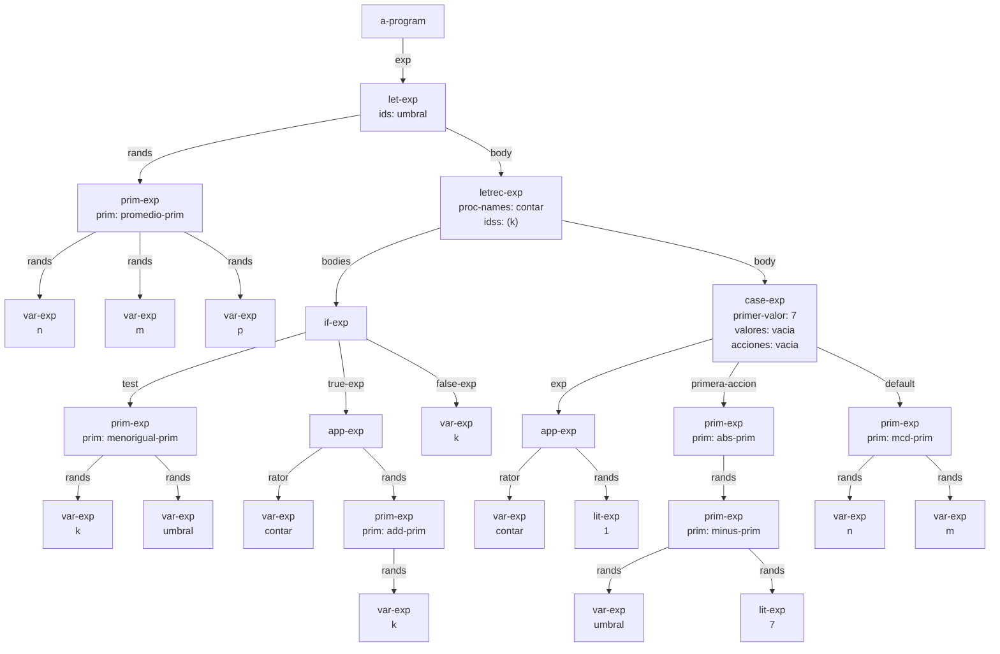
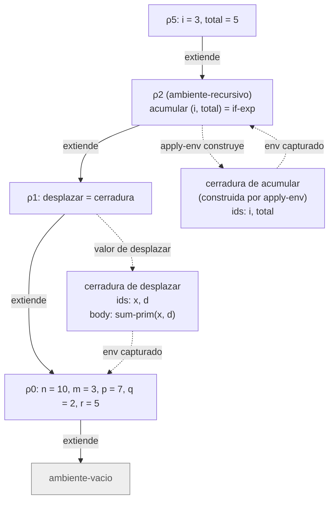

# Informe de AST — Taller 2: El intérprete de Cauca

**Curso:** Fundamentos de Interpretación y Compilación de Lenguajes
de Programación — Universidad del Valle, Sede Tuluá.

**Integrantes del grupo:**

| Nombre | Código | Correo institucional |
|--------|--------|----------------------|
| Nicolás Cardona García | 2477349 | nicolas.cardona.garcia@correounivalle.edu.co |
| Laura Sofía Echeverry González | 2477067 | echeverry.laura@correounivalle.edu.co |
| Santiago Serrano Morales | 2477006 | serrano.santiago@correounivalle.edu.co |
| Samuel Peña Jaramillo | 2477399 | samuel.pena@correounivalle.edu.co |

---

## 1. Gramática considerada

Gramática de Cauca tal como está implementada en `src/sintaxis.rkt`. Entre
paréntesis van los campos de cada constructor del datatype.

```bnf
<programa>  ::= <expresion>
                a-program(exp)

<expresion> ::= <numero>
                lit-exp(dato)
            ::= <identificador>
                var-exp(id)
            ::= "true"
                true-exp()
            ::= "false"
                false-exp()
            ::= <primitiva> "(" {<expresion>}*(,) ")"
                prim-exp(prim, rands)
            ::= "if" <expresion> "then" <expresion> "else" <expresion> "end"
                if-exp(test, true-exp, false-exp)
            ::= "let" {<identificador> "=" <expresion>}* "in" <expresion> "end"
                let-exp(ids, rands, body)
            ::= "proc" "(" {<identificador>}*(,) ")" <expresion> "end"
                proc-exp(ids, body)
            ::= "apply" <expresion> "(" {<expresion>}*(,) ")"
                app-exp(rator, rands)
            ::= "letrec" {<identificador> "(" {<identificador>}*(,) ")" "=" <expresion>}*
                "in" <expresion> "end"
                letrec-exp(proc-names, idss, bodies, body)
            ::= "case" <expresion> "of" <numero> "=>" <expresion>
                {"of" <numero> "=>" <expresion>}* "otherwise" "=>" <expresion> "end"
                case-exp(exp, primer-valor, primera-accion, valores, acciones, default)

<primitiva> ::= "+" sum-prim() | "-" minus-prim() | "*" mult-prim() | "/" div-prim()
            ::= "add1" add-prim() | "sub1" sub-prim()
            ::= ">" mayor-prim() | ">=" mayorigual-prim()
            ::= "<" menor-prim() | "<=" menorigual-prim() | "==" igual-prim()
            ::= "not" not-prim() | "and" and-prim() | "or" or-prim()
            ::= "abs" abs-prim() | "mcd" mcd-prim() | "mcm" mcm-prim()
            ::= "promedio" promedio-prim() | "xor" xor-prim()
            ::= "implica" implica-prim() | "entre" entre-prim()
```

SLLGEN no tiene la repetición `{...}+`. Por eso `case` pide una primera rama
obligatoria seguida de `arbno`, y `case-exp` tiene seis campos: `exp`,
`primer-valor`, `primera-accion`, `valores`, `acciones` y `default`.

---

## 2. Ejemplos de AST

### Ejemplo 1 — Programa con `let`, `letrec` y `case`

**Expresión concreta:**

```scheme
let umbral = promedio(n, m, p)
in
  letrec
    contar (k) = if <=(k, umbral)
                 then apply contar (add1(k))
                 else k
                 end
  in
    case apply contar (1)
      of 7 => abs(-(umbral, 7))
      otherwise => mcd(n, m)
    end
  end
end
```

**AST:**



**Explicación:** la raíz `a-program` contiene un `let-exp` que liga `umbral`
a un `prim-exp` con `promedio-prim` y los tres argumentos `n`, `m` y `p`
(`var-exp`). El cuerpo del `let` es un `letrec-exp` con un solo
procedimiento, `contar`, de parámetro `k`. Su cuerpo (en `bodies`) es un
`if-exp` cuya condición es `<=(k, umbral)`; la rama `then` es una aplicación
recursiva (`app-exp`) con `add1(k)` como argumento, y la rama `else` es
`var-exp k`. El cuerpo del `letrec` es un `case-exp`: la expresión de control
es `apply contar (1)`, la única rama es `7 => abs(-(umbral, 7))` y la rama
`otherwise` es `mcd(n, m)`. Al ejecutarlo, el resultado es $\tfrac{1}{3}$:
`umbral` vale $\tfrac{20}{3}$, `contar` termina en $7$ y
$\left|\tfrac{20}{3} - 7\right| = \tfrac{1}{3}$.

---

## 3. Traza de evaluación

**Expresión a evaluar:**

```scheme
let desplazar = proc (x, d) +(x, d) end
in
  letrec
    acumular (i, total) = if >(i, m)
                          then total
                          else apply acumular
                                 (add1(i), apply desplazar (total, i))
                          end
  in
    apply acumular (1, q)
  end
end
```

**Ambiente inicial:** $\rho_0 = [\,n = 10,\ m = 3,\ p = 7,\ q = 2,\ r = 5\,]$.

**Definiciones.** Sea $B_a$ el cuerpo de `acumular` (el `if-exp` completo) y
$B_d = \texttt{+(x, d)}$ el cuerpo de `desplazar`.

- $C_d = \texttt{cerradura}((x, d),\ B_d,\ \rho_0)$: la clausura de `desplazar` captura $\rho_0$, el ambiente donde se evaluó el `proc-exp`.
- $\rho_1 = [\,\text{desplazar} = C_d\,] \cdot \rho_0$.
- $\rho_2 = \texttt{ambiente-recursivo}(\text{acumular},\ (i, total),\ B_a,\ \rho_1)$.
- Al buscar `acumular` en $\rho_2$, `apply-env` construye $C_a = \texttt{cerradura}((i, total),\ B_a,\ \rho_2)$: el ambiente de la clausura es el propio ambiente recursivo.
- Cada llamada a `acumular` evalúa $B_a$ en un ambiente de la forma $[\,i = \cdot,\ total = \cdot\,] \cdot \rho_2$.

**Pasos de la traza:**

### Paso 1 — `let` externo

$$\textit{value-of}\;(\texttt{let desplazar = proc (x, d) +(x, d) end in } \ldots)\ \rho_0$$

1. Se evalúa el rand `proc (x, d) +(x, d) end` en $\rho_0$. Un `proc-exp` no evalúa el cuerpo:
   $$\textit{value-of}\;(\texttt{proc (x, d) +(x, d) end})\ \rho_0 = C_d$$
2. Se extiende el ambiente: $\rho_1 = [\,\text{desplazar} = C_d\,] \cdot \rho_0$.
3. Se evalúa el cuerpo del `let` en $\rho_1$.

### Paso 2 — `letrec`

$$\textit{value-of}\;(\texttt{letrec acumular (i, total) = } B_a \texttt{ in apply acumular (1, q) end})\ \rho_1$$

Se construye $\rho_2$ sin evaluar $B_a$, y se evalúa `apply acumular (1, q)` en $\rho_2$:

$$\rho_2 = [\,\text{acumular} = \langle\texttt{rec}\rangle,\ \text{desplazar} = C_d,\ n = 10,\ m = 3,\ p = 7,\ q = 2,\ r = 5\,]$$

### Paso 3 — aplicación inicial

$$\textit{value-of}\;(\texttt{apply acumular (1, q)})\ \rho_2$$

| Subexpresión | Ambiente | Resultado |
|---|---|---|
| `acumular` (operador) | $\rho_2$ | $C_a$ (construida por `apply-env` sobre `ambiente-recursivo`) |
| `1` | $\rho_2$ | $1$ |
| `q` | $\rho_2$ | $2$ |

`apply-procedure` $(C_a, (1, 2))$ evalúa $B_a$ en
$$\rho_3 = [\,i = 1,\ total = 2\,] \cdot \rho_2 .$$

### Paso 4 — llamada inicial: $i = 1,\ total = 2$

$$\textit{value-of}\;(B_a)\ \rho_3$$

| Subexpresión | Ambiente | Resultado |
|---|---|---|
| `>(i, m)` | $\rho_3$ | $\texttt{>}(1, 3) = \texttt{\#f}$ |
| `add1(i)` | $\rho_3$ | $2$ |
| `desplazar` (operador) | $\rho_3$ | $C_d$ |
| `total`, `i` | $\rho_3$ | $2,\ 1$ |
| cuerpo $B_d$ | $[\,x = 2,\ d = 1\,] \cdot \rho_0$ | $\texttt{+}(2, 1) = 3$ |
| `apply acumular (2, 3)` | $\rho_3$ | se invoca $C_a$ con $(2, 3)$ |

El cuerpo de `desplazar` se evalúa en $\rho_0$ extendido (ambiente de definición), no en $\rho_3$.

### Paso 5 — primera llamada recursiva: $i = 2,\ total = 3$

$$\rho_4 = [\,i = 2,\ total = 3\,] \cdot \rho_2$$

| Subexpresión | Ambiente | Resultado |
|---|---|---|
| `>(i, m)` | $\rho_4$ | $\texttt{>}(2, 3) = \texttt{\#f}$ |
| `add1(i)` | $\rho_4$ | $3$ |
| `apply desplazar (total, i)` | $\rho_4$ | cuerpo en $[\,x = 3,\ d = 2\,] \cdot \rho_0$ $\Rightarrow 5$ |
| `apply acumular (3, 5)` | $\rho_4$ | se invoca $C_a$ con $(3, 5)$ |

### Paso 6 — segunda llamada recursiva: $i = 3,\ total = 5$

$$\rho_5 = [\,i = 3,\ total = 5\,] \cdot \rho_2$$

| Subexpresión | Ambiente | Resultado |
|---|---|---|
| `>(i, m)` | $\rho_5$ | $\texttt{>}(3, 3) = \texttt{\#f}$ |
| `add1(i)` | $\rho_5$ | $4$ |
| `apply desplazar (total, i)` | $\rho_5$ | cuerpo en $[\,x = 5,\ d = 3\,] \cdot \rho_0$ $\Rightarrow 8$ |
| `apply acumular (4, 8)` | $\rho_5$ | se invoca $C_a$ con $(4, 8)$ |

### Paso 7 — tercera llamada recursiva: $i = 4,\ total = 8$ (caso base)

$$\rho_6 = [\,i = 4,\ total = 8\,] \cdot \rho_2$$

| Subexpresión | Ambiente | Resultado |
|---|---|---|
| `>(i, m)` | $\rho_6$ | $\texttt{>}(4, 3) = \texttt{\#t}$ |
| `total` (rama `then`) | $\rho_6$ | $8$ |

### Resultado

$$\textit{value-of}\;(\text{programa})\ \rho_0 = 8$$

**Diagrama de la cadena de ambientes** en la segunda llamada recursiva (ambiente $\rho_5$ del Paso 6). Las flechas continuas van del ambiente que extiende hacia el ambiente extendido; las punteadas indican qué ambiente captura una clausura.



**Lectura:** al evaluar $B_a$ en $\rho_5$, la búsqueda de `acumular` sube de $[\,i = 3,\ total = 5\,]$ al `ambiente-recursivo`, que reconstruye la clausura con él mismo como ambiente. Por eso el nombre sigue visible en cada nueva llamada. La búsqueda de `desplazar` continúa hasta $\rho_1$, y su cuerpo se evalúa en $\rho_0$ extendido con $x$ y $d$, es decir, en el ambiente donde nació.

---

## 4. Estado del almacén en una transacción

No aplica: Cauca no tiene almacén ni bloques transaccionales, y el enunciado de este taller no pide este ejercicio.

---

## 5. Referencias

- Friedman, D. P., & Wand, M. *Essentials of Programming Languages*,
  3.ª ed., MIT Press, 2008. Secciones 2.5 (sintaxis abstracta),
  2.2 (ambientes), 3.2 (el lenguaje LET), 3.3 (procedimientos y
  clausuras, Figura 3.7) y 3.4 (procedimientos recursivos, Figura 3.9).
- The Racket Guide, *Parsing with SLLGEN*, en la documentación del
  lenguaje `eopl`.