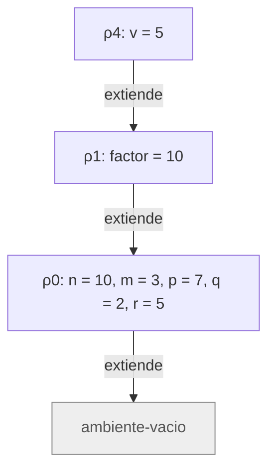
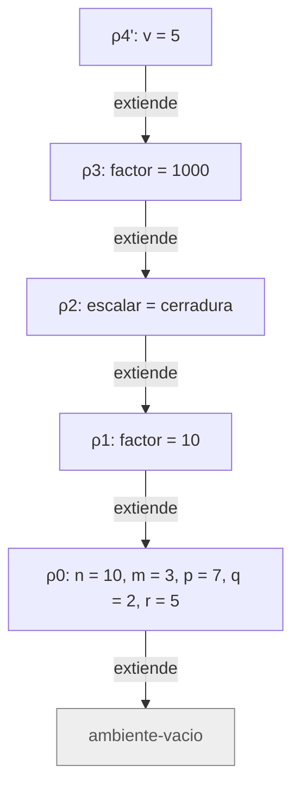
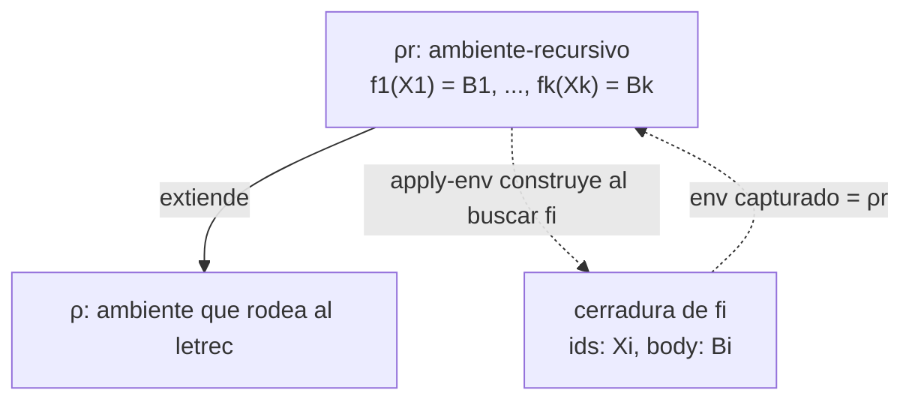

# Informe de corrección — Taller 2: El intérprete de Cauca

**Curso:** Fundamentos de Interpretación y Compilación de Lenguajes
de Programación — Universidad del Valle, Sede Tuluá.

**Integrantes del grupo:**

| Nombre | Código | Correo institucional |
|--------|--------|----------------------|
| Nicolás Cardona García | 2477349 | nicolas.cardona.garcia@correounivalle.edu.co |
| Laura Sofía Echeverry González | 2477067 | echeverry.laura@correounivalle.edu.co |
| Santiago Serrano Morales | 2477006 | serrano.santiago@correounivalle.edu.co |
| Samuel Peña Jaramillo | 2477399 | samuel.pena@correounivalle.edu.co |

---

## 1. Marco formal

### 1.1 Corrección de programas recursivos

Sea $f : A \to B$ una función y $A$ un conjunto definido recursivamente. Sea $P_f$ un programa recursivo en Racket que pretende calcular $f$. Decimos que $P_f$ es **correcto** con respecto a su especificación si se cumple:

$$\forall a \in A,\; P_f(a) = f(a)$$

La estrategia de demostración es la inducción estructural sobre $A$:

- **Caso base:** para cada valor básico $a_0 \in A$ se verifica $P_f(a_0) = f(a_0)$.
- **Caso inductivo:** asumiendo la hipótesis de inducción $P_f(a') = f(a')$ para las subestructuras $a'$ que forman $a$, se demuestra $P_f(a) = f(a)$.

### 1.2 Corrección de programas iterativos

Para un programa iterativo se formalizan:

- Un estado $s$ con componentes relevantes.
- Un estado inicial $s_0$.
- Un estado final reconocido por un predicado $\textit{es-final?}(s)$.
- Una invariante $\mathrm{Inv}(s)$ que se mantiene entre pasos.
- Una transformación $\textit{transformar}(s)$.

La corrección se argumenta demostrando:

1. $\mathrm{Inv}(s_0)$ se cumple al inicio.
2. $\mathrm{Inv}(s) \land \lnot\,\textit{es-final?}(s) \Rightarrow \mathrm{Inv}(\textit{transformar}(s))$.
3. $\mathrm{Inv}(s) \land \textit{es-final?}(s) \Rightarrow \textit{respuesta}(s) = f(\textit{entrada})$.
4. El proceso termina: existe una función de cota estrictamente decreciente sobre $\mathbb{N}$.

Todas las funciones analizadas en este informe son recursivas (directa o mutuamente), por lo que se usa el marco 1.1; el marco 1.2 se incluye por completitud.

---

## 2. Funciones analizadas

El enunciado pide demostrar la corrección de tres piezas del intérprete: `apply-procedure` (con la regla `app-exp` que la invoca), la ligadura recursiva `letrec` (con `apply-env` sobre `ambiente-recursivo`) y `case-exp` (con `seleccionar-caso`).

### Notación común

- $\rho$ es un ambiente. $\varnothing$ es `ambiente-vacio`.
- $\mathrm{ext}(X, V, \rho)$ es `ambiente-extendido` con ids $X = (x_1,\ldots,x_n)$, valores $V = (v_1,\ldots,v_n)$ y ambiente padre $\rho$.
- $\mathrm{rec}(F, \bar X, \bar B, \rho)$ es `ambiente-recursivo` con nombres $F = (f_1,\ldots,f_k)$, listas de parámetros $\bar X = (X_1,\ldots,X_k)$, cuerpos $\bar B = (B_1,\ldots,B_k)$ sin evaluar y ambiente padre $\rho$.
- $\langle X, B, \rho \rangle$ es una `cerradura` con parámetros $X$, cuerpo $B$ y ambiente $\rho$.
- $\rho_0 = [\,n = 10,\ m = 3,\ p = 7,\ q = 2,\ r = 5\,]$ es el ambiente inicial.
- $\textit{value-of}(e, \rho)$ es el valor de la expresión $e$ en $\rho$. Cuando un paso levanta `eopl:error`, se escribe $\textit{error}$.

**Búsqueda de una variable** (`apply-env`). Con $\mathrm{buscar}(\rho, y)$:

$$\mathrm{buscar}(\varnothing, y) = \textit{error}$$

$$\mathrm{buscar}(\mathrm{ext}(X, V, \rho), y) =
\begin{cases}
v_i, \ i = \min\{\, j : x_j = y \,\} & \text{si } y \in X \\
\mathrm{buscar}(\rho, y) & \text{si } y \notin X
\end{cases}$$

$$\mathrm{buscar}(\mathrm{rec}(F, \bar X, \bar B, \rho), y) =
\begin{cases}
\langle X_i, B_i, \mathrm{rec}(F, \bar X, \bar B, \rho) \rangle, \ i = \min\{\, j : f_j = y \,\} & \text{si } y \in F \\
\mathrm{buscar}(\rho, y) & \text{si } y \notin F
\end{cases}$$

En la tercera ecuación el ambiente de la clausura es el propio $\mathrm{rec}(F, \bar X, \bar B, \rho)$ sobre el que se hizo la búsqueda: es la línea `(cerradura (list-ref idss pos) (list-ref bodies pos) env)` de `apply-env`, donde `env` es el argumento de `apply-env` y no `env-padre`.

**Reglas de evaluación usadas:**

$$\textit{value-of}(\texttt{proc-exp}(X, B), \rho) = \langle X, B, \rho \rangle$$

$$\textit{value-of}(\texttt{app-exp}(r, (e_1, \ldots, e_m)), \rho) = \textit{apply-procedure}(v_f, (v_1, \ldots, v_m))$$

con $v_f = \textit{value-of}(r, \rho)$ y $v_i = \textit{value-of}(e_i, \rho)$, evaluados de izquierda a derecha, siempre que $v_f$ sea un procedimiento.

$$\textit{value-of}(\texttt{letrec-exp}(F, \bar X, \bar B, B_0), \rho) = \textit{value-of}(B_0, \mathrm{rec}(F, \bar X, \bar B, \rho))$$

Las demostraciones son de **corrección parcial** respecto a la terminación de las subexpresiones del usuario: si el cuerpo de un procedimiento no termina, ninguna propiedad sobre su valor puede cumplirse. La terminación de cada función del intérprete se argumenta aparte.

---

### 2.1 Corrección de `apply-procedure`

**Especificación.**

- **Tipo:** `apply-procedure` : `procval` $\times$ lista de valores $\to$ valor.
- **Pre-condición:** $\mathrm{Pre}(p, \bar v) \equiv p = \langle X, B, \rho_c \rangle$, con $X = (x_1,\ldots,x_n)$ una lista de símbolos, $B$ una expresión y $\rho_c$ el ambiente vigente cuando se evaluó el `proc-exp`; y $\bar v = (v_1,\ldots,v_m)$ una lista de valores.
- **Post-condición:**

$$\mathrm{Post}(p, \bar v, r) \equiv
\bigl(m = n \;\land\; r = \textit{value-of}(B, \mathrm{ext}(X, \bar v, \rho_c))\bigr)
\;\lor\;
\bigl(m \neq n \;\land\; r = \textit{error}\bigr)$$

**Código.**

```scheme
; apply-procedure : procval x lista de valores -> valor
; Propósito: verifica que la cantidad de argumentos coincida con la de
; parámetros y evalúa el cuerpo en el ambiente de la clausura extendido
; con las ligaduras de los parámetros, no en el ambiente de la llamada.
(define apply-procedure
  (lambda (proc args)
    (cases procval proc
      (cerradura (ids body env-definicion)
        (if (= (length ids) (length args))
            (evaluar-expresion
             body
             (ambiente-extendido ids args env-definicion))
            (eopl:error
             'apply-procedure
             "se esperaban ~s argumento(s) y llegaron ~s"
             (length ids)
             (length args)))))))
```

La regla que construye la clausura y la que la aplica, en `evaluar-expresion`:

```scheme
(proc-exp (ids body)
  (cerradura ids body env))

(app-exp (rator rands)
  (let ((proc (evaluar-expresion rator env)))
    (if (procval? proc)
        (let ((args (evaluar-rands rands env)))
          (apply-procedure proc args))
        (eopl:error 'app-exp "el operador no es un procedimiento: ~s" proc))))
```

**Estrategia de demostración:** análisis por casos sobre la condición `(= (length ids) (length args))` y razonamiento directo sobre el código, que no es recursivo por sí mismo. La recursión aparece solo a través de `evaluar-expresion`, para la cual se usa como hipótesis que es correcta sobre expresiones de menor tamaño (inducción sobre el árbol de evaluación).

#### Demostración de la especificación

`apply-procedure` descompone $p$ con `cases` en $\langle X, B, \rho_c \rangle$ y compara $n = |X|$ con $m = |\bar v|$.

- **Caso $m = n$:** el `if` toma la rama verdadera y retorna `(evaluar-expresion body (ambiente-extendido ids args env-definicion))`, es decir, $\textit{value-of}(B, \mathrm{ext}(X, \bar v, \rho_c))$. Se cumple la primera alternativa de $\mathrm{Post}$.
- **Caso $m \neq n$:** el `if` toma la rama falsa y levanta `eopl:error`. Se cumple la segunda alternativa.

Las dos alternativas son excluyentes y cubren todos los casos, así que $\mathrm{Post}$ se cumple. $\blacksquare$

#### El cuerpo se evalúa en el ambiente de la clausura y no en el de la llamada

**Lema A (la clausura captura el ambiente de definición).** Si $\textit{value-of}(\texttt{proc-exp}(X, B), \rho) = c$, entonces $c = \langle X, B, \rho \rangle$.

*Prueba.* Es la regla `(proc-exp (ids body) (cerradura ids body env))`: el tercer campo es el parámetro `env` de `evaluar-expresion` en el instante de evaluar el `proc-exp`, que es $\rho$. El cuerpo no se evalúa al construir la clausura. $\blacksquare$

**Lema B (`apply-procedure` no conoce el ambiente de la llamada).** El único ambiente que `apply-procedure` puede usar es el que trae la clausura.

*Prueba.* La función solo recibe `proc` y `args`; el ambiente donde ocurre la aplicación, $\rho_{\text{llamada}}$, no es parámetro suyo. En el código, el único ambiente que aparece es `env-definicion`, extraído de la clausura. Por tanto el cuerpo solo puede evaluarse en $\mathrm{ext}(X, \bar v, \rho_c)$. $\blacksquare$

**Teorema.** Si $c = \langle X, B, \rho_c \rangle$ se aplica en una llamada hecha en $\rho_{\text{llamada}}$ con $m = n$ argumentos, el cuerpo se evalúa en $\mathrm{ext}(X, \bar v, \rho_c)$ y no en $\mathrm{ext}(X, \bar v, \rho_{\text{llamada}})$.

*Prueba.* Por el Lema A, $\rho_c$ es el ambiente de definición; por el Lema B, el cuerpo se evalúa extendiendo $\rho_c$. Los argumentos $\bar v$ sí se evalúan en $\rho_{\text{llamada}}$ (regla `app-exp`), pero ese es el único uso que se hace de ese ambiente. $\blacksquare$

#### Ejemplo de contraste de la Parte 3

```
let factor = 10
in
  let escalar = proc (v) *(v, factor) end
  in
    let factor = 1000
    in apply escalar (5) end
  end
end
```

Paso a paso:

| Ambiente | Definición |
|---|---|
| $\rho_1$ | $\mathrm{ext}((\textit{factor}), (10), \rho_0)$ |
| $c$ | $\langle (v),\ \texttt{*(v, factor)},\ \rho_1 \rangle$, porque el `proc-exp` se evalúa en $\rho_1$ |
| $\rho_2$ | $\mathrm{ext}((\textit{escalar}), (c), \rho_1)$ |
| $\rho_3$ | $\mathrm{ext}((\textit{factor}), (1000), \rho_2)$ — ambiente de la llamada |

En `apply escalar (5)` el operador se resuelve en $\rho_3$: $\mathrm{buscar}(\rho_3, \textit{escalar}) = c$, porque `escalar` no está en $\rho_3$ y se busca en $\rho_2$. El argumento vale $5$.

**Evaluación correcta (la implementada).** El cuerpo se evalúa en $\rho_4 = \mathrm{ext}((v), (5), \rho_1)$. Para `factor`: no está en $\rho_4$, se busca en $\rho_1$ y se obtiene $10$. Resultado: $5 \cdot 10 = 50$.

**Evaluación incorrecta (ambiente de la llamada).** El cuerpo se evaluaría en $\rho_4' = \mathrm{ext}((v), (5), \rho_3)$. Para `factor`: no está en $\rho_4'$, se encuentra en $\rho_3$ y se obtiene $1000$. Resultado: $5 \cdot 1000 = 5000$.

Cadena de ambientes que da **50** (flechas del ambiente que extiende hacia el ambiente extendido):



Cadena de ambientes que daría **5000**:



En la primera cadena, la búsqueda de `factor` llega a $\rho_1$ antes que a cualquier ligadura posterior a la definición. En la segunda, encuentra primero $\rho_3$, creado después de la clausura. El intérprete implementa la primera cadena; al ejecutar el ejemplo devuelve `50`.

#### La aplicación levanta error exactamente cuando el operador no es un procedimiento o la cantidad de argumentos no coincide

Se llama *error propio de la aplicación* al que levantan `app-exp` o `apply-procedure` por sí mismos, distinto de los que se propagan desde la evaluación del operador, de los argumentos o del cuerpo.

**Teorema.** Sean $v_f$ el valor del operador y $\bar v = (v_1,\ldots,v_m)$ los valores de los argumentos, y supóngase que su evaluación terminó sin error. La aplicación levanta un error propio si y solo si

$$\lnot\,\textit{procval?}(v_f) \;\;\lor\;\; \bigl(v_f = \langle X, B, \rho_c \rangle \;\land\; |X| \neq m\bigr).$$

*Prueba.*

($\Leftarrow$) Si $\lnot\,\textit{procval?}(v_f)$, la rama falsa del `if` de `app-exp` levanta `"el operador no es un procedimiento"`. Si $v_f$ es una clausura con $|X| \neq m$, `apply-procedure` levanta el error de cantidad, como se demostró arriba.

($\Rightarrow$) En el código de `app-exp` y `apply-procedure` hay exactamente dos llamadas a `eopl:error`: la de `app-exp` en la rama donde `procval?` es falso, y la de `apply-procedure` en la rama donde `(= (length ids) (length args))` es falso. Si se levanta un error propio, se llegó a una de esas dos ramas, y cada una implica una de las dos condiciones del enunciado. Cuando $v_f$ es procedimiento y $|X| = m$, ninguna rama de error se ejecuta; solo podría fallar la evaluación del cuerpo, que no es un error propio. $\blacksquare$

**Orden de las verificaciones.** `app-exp` evalúa el operador y lo verifica con `procval?` antes de evaluar los argumentos. Por eso `apply 5 (variableinexistente)` produce el error del operador y no el de variable no ligada, como comprueban las pruebas de `pruebas-cauca.rkt`.

**Terminación.** `apply-procedure` no es recursiva: hace una comparación de longitudes, a lo sumo una extensión del ambiente y una sola llamada a `evaluar-expresion`. Su terminación depende de la del cuerpo evaluado.

**Conclusión:** `apply-procedure` es correcta respecto a su especificación: evalúa el cuerpo en $\mathrm{ext}(X, \bar v, \rho_c)$, nunca en el ambiente de la llamada, y levanta error exactamente cuando el operador no es un procedimiento o la cantidad de argumentos no coincide con la de parámetros.

---

### 2.2 Corrección de la ligadura recursiva (`letrec` y `apply-env`)

**Especificación.**

- **Tipo:** `letrec-exp` evalúa a valor con `evaluar-expresion` : `expresion` $\times$ `ambiente` $\to$ valor; la pieza clave es `apply-env` : `ambiente` $\times$ `symbol` $\to$ valor.
- **Pre-condición:** $F = (f_1,\ldots,f_k)$ son los nombres declarados, con listas de parámetros $\bar X$ y cuerpos $\bar B$ sin evaluar. Si hay nombres repetidos vale la primera aparición.
- **Post-condición:** el cuerpo $B_0$ del `letrec` se evalúa en $\rho_r = \mathrm{rec}(F,\bar X,\bar B,\rho)$. Cada nombre de procedimiento declarado resuelve a la clausura correspondiente a su primera aparición, con sus parámetros y cuerpo asociados y con $\rho_r$ como ambiente capturado.

**Código.**

```scheme
; apply-env : ambiente x symbol -> valor
; Busca el identificador en el ambiente, respetando el shadowing de las
; ligaduras más recientes, y levanta eopl:error si no está ligado.
(define apply-env
  (lambda (env id)
    (cases ambiente env
      (ambiente-vacio ()
        (eopl:error 'apply-env "Variable no ligada: ~s" id))
      (ambiente-extendido (ids valores env-padre)
        (let ((pos (posicion-de id ids)))
          (if (number? pos)
              (list-ref valores pos)
              (apply-env env-padre id))))
      (ambiente-recursivo (proc-names idss bodies env-padre)
        (let ((pos (posicion-de id proc-names)))
          (if pos
              (cerradura (list-ref idss pos)
                         (list-ref bodies pos) env)
              (apply-env env-padre id)))))))
```

```scheme
(letrec-exp (proc-names idss bodies body)
  (let ((env-rec
         (ambiente-recursivo proc-names idss bodies env)))
    (evaluar-expresion body env-rec)))
```
#### Representación de procedimientos mediante clausuras

La implementación representa los procedimientos mediante el tipo de dato `procval`, cuya variante `cerradura` almacena tres componentes: la lista de parámetros (`ids`), el cuerpo del procedimiento (`body`) y el ambiente donde fue definido (`env`). El cuerpo se conserva sin evaluar hasta que el procedimiento es invocado.

Esta representación permite implementar el alcance léxico. En `apply-procedure`, los argumentos se asocian con los parámetros mediante `ambiente-extendido`, utilizando como ambiente padre el ambiente capturado por la clausura. De esta manera, el cuerpo se evalúa en el entorno donde se definió el procedimiento, extendido con los valores de sus argumentos, y no en el entorno desde el cual se realizó la llamada.

En el caso de `letrec`, `apply-env` construye la clausura de un procedimiento declarado recursivamente utilizando el ambiente recursivo como ambiente capturado. Esto es fundamental para que, durante la evaluación del cuerpo del procedimiento, sus propias referencias y las de los demás procedimientos declarados en el mismo `letrec` puedan resolverse correctamente.

**Estrategia de demostración:** razonamiento directo sobre `apply-env`, inducción estructural sobre la cadena de ambientes para las búsquedas a través de extensiones, e inducción sobre el exponente para el ejemplo de la potencia.

#### 1. Invariante

Sea $\rho_r = \mathrm{rec}(F, \bar X, \bar B, \rho)$ el ambiente recursivo creado por `letrec`, donde $F=(f_1,\ldots,f_k)$ contiene los nombres de los procedimientos, $\bar X=(X_1,\ldots,X_k)$ sus listas de parámetros y $\bar B=(B_1,\ldots,B_k)$ sus cuerpos.

Como `posicion-de` devuelve la posición de la primera aparición de un identificador, si existen nombres de procedimientos repetidos, solamente la primera declaración de cada nombre es accesible mediante la búsqueda por identificador.

Para cada índice $i$ correspondiente a la primera aparición de su nombre en $F$, el procedimiento $f_i$ se evalúa en un ambiente de la forma:

$$\rho_b = \mathrm{ext}(X_i,\bar v,\rho_r)$$

donde $\bar v$ representa los valores de los argumentos recibidos por el procedimiento.

Definimos el siguiente invariante para el cuerpo de cada procedimiento:

$$\mathrm{Inv}_{\mathrm{cuerpo}}(\rho_b,i)\equiv\forall j\in\{1,\ldots,k\},\left[\begin{aligned}&f_j \text{ es la primera aparición de su nombre en }F\\&\land\ f_j\notin X_i\end{aligned}\right]\Rightarrow\mathrm{buscar}(\rho_b,f_j)=\langle X_j,B_j,\rho_r\rangle$$

El invariante establece que, al evaluar el cuerpo del procedimiento $f_i$, cualquier nombre de procedimiento declarado en el `letrec` que no esté oculto por uno de sus parámetros debe resolver a la clausura correspondiente a su primera declaración. Esta clausura contiene sus parámetros $X_j$, su cuerpo $B_j$ y el mismo ambiente recursivo $\rho_r$ como ambiente capturado.

La condición $f_j\notin X_i$ contempla el *shadowing* legítimo: si un parámetro del procedimiento actual tiene el mismo nombre que un procedimiento declarado en el `letrec`, el parámetro tiene prioridad durante la búsqueda y oculta la ligadura del ambiente recursivo dentro del cuerpo.

Por tanto, siempre que el nombre de un procedimiento no esté oculto por los parámetros del procedimiento actual, su búsqueda debe recuperar la clausura correcta y conservar el acceso a las declaraciones recursivas.

#### 2. `apply-env` sobre un ambiente recursivo construye una clausura que cumple el invariante

**Lema 1 (resolución de procedimientos en el ambiente recursivo).** Sea $f_i$ un nombre de procedimiento cuya primera aparición en $F$ se encuentra en la posición $i$. Entonces:

$$\mathrm{buscar}(\rho_r,f_i)=\langle X_i,B_i,\rho_r\rangle$$

*Prueba.* Al evaluar `(apply-env ρr fi)`, la implementación entra en la variante `ambiente-recursivo`. La función `posicion-de` devuelve la posición de la primera coincidencia de $f_i$ en `proc-names`. Como $i$ corresponde a la primera aparición de ese nombre, la posición obtenida es $i$. A continuación, `apply-env` construye y retorna la clausura con los parámetros $X_i$, el cuerpo $B_i$ y el propio ambiente recursivo $\rho_r$ como ambiente capturado. Por tanto, se cumple la igualdad. $\blacksquare$

**Lema 2 (búsqueda a través de extensiones).** Sea

$$\sigma =\mathrm{ext}(Y_1,W_1,\mathrm{ext}(Y_2,W_2,\ldots\mathrm{ext}(Y_t,W_t,\rho_r)))$$

Si $f_j\notin Y_s$ para todo $s\in\{1,\ldots,t\}$, entonces:

$$\mathrm{buscar}(\sigma,f_j)=\mathrm{buscar}(\rho_r,f_j)$$

*Prueba.* Por inducción sobre el número $t$ de extensiones. Si $t=0$, se tiene $\sigma=\rho_r$, por lo que la igualdad es inmediata. Si $t>0$, como $f_j\notin Y_1$, la búsqueda en la primera extensión continúa en el ambiente padre. Por tanto, la búsqueda equivale a realizarla sobre las $t-1$ extensiones restantes. Aplicando la hipótesis de inducción, se obtiene la búsqueda en $\rho_r$. $\blacksquare$

**Teorema (invariante de los cuerpos de procedimientos).** Para todo procedimiento $f_i$ cuya primera aparición se encuentra en la posición $i$, al evaluar su cuerpo $B_i$ mediante `apply-procedure`, el ambiente de evaluación $\rho_b$ satisface:

$$\mathrm{Inv}_{\mathrm{cuerpo}}(\rho_b,i)$$

En consecuencia, todo nombre de procedimiento declarado en el `letrec` que no esté oculto por los parámetros de $f_i$ se resuelve a la clausura correspondiente a su primera declaración.

*Prueba.* Por el Lema 1, la búsqueda de $f_i$ en el ambiente recursivo $\rho_r$ devuelve la clausura $\langle X_i,B_i,\rho_r\rangle$. Al aplicar esa clausura, `apply-procedure` extiende el ambiente capturado con los parámetros y los valores recibidos. Por tanto, el cuerpo se evalúa en:

$$\rho_b=\mathrm{ext}(X_i,\bar v,\rho_r)$$

Sea $f_j$ cualquier nombre de procedimiento cuya primera aparición esté en la posición $j$ y que no pertenezca a $X_i$. Por el Lema 2, aplicado a la extensión de los parámetros, se cumple:

$$\mathrm{buscar}(\rho_b,f_j)=\mathrm{buscar}(\rho_r,f_j)$$

Como $f_j$ corresponde a su primera declaración, el Lema 1 establece que:

$$\mathrm{buscar}(\rho_r,f_j)=\langle X_j,B_j,\rho_r\rangle$$

En consecuencia:

$$\mathrm{buscar}(\rho_b,f_j)=\langle X_j,B_j,\rho_r\rangle$$

Esta es precisamente la propiedad exigida por el invariante. Como el razonamiento vale para todo $f_j$ que cumpla las condiciones establecidas, el invariante se satisface.

Por tanto, las llamadas recursivas y mutuas pueden resolver los nombres de los procedimientos declarados en el `letrec`, siempre que esos nombres no estén ocultos por los parámetros del procedimiento actual. Cada búsqueda recupera la clausura correspondiente, que conserva el mismo ambiente recursivo $\rho_r$. $\blacksquare$

Estructura de la cadena (el ambiente de la clausura es el propio ambiente recursivo):



#### 3. Por qué la misma declaración con `let` no cumple el invariante

Con `let`, los rands se evalúan **en el ambiente de afuera**:

$$\textit{value-of}(\texttt{let-exp}((f), (\texttt{proc-exp}(X, B_f)), B_0), \rho) = \textit{value-of}(B_0, \mathrm{ext}((f), (c), \rho)), \quad c = \langle X, B_f, \rho \rangle.$$

La clausura $c$ captura $\rho$, no $\mathrm{ext}((f), (c), \rho)$: en el momento de construirla, $f$ todavía no está ligada. Entonces $\mathrm{buscar}(\mathrm{env}(c), f) = \mathrm{buscar}(\rho, f)$, que no es $c$. El invariante se viola.

**Error concreto.** Al aplicar $c$, el cuerpo $B_f$ se evalúa en $\mathrm{ext}(X, \bar v, \rho)$. La ocurrencia recursiva de $f$ se busca ahí; si $f \notin \rho$, la búsqueda llega a $\varnothing$ y se levanta el error de variable no ligada. Con el intérprete:

```
let factorial = proc (n)
                  if ==(n, 0) then 1
                  else *(n, apply factorial (sub1(n))) end
                end
in apply factorial (5) end
```

devuelve el error `apply-env: Variable no ligada: factorial`, mientras que la versión con `letrec` devuelve `120`.

Si $f$ ya estaba ligada en $\rho$ a otra cosa, el error es peor porque pasa en silencio: la llamada recursiva usa la ligadura **anterior**. Por ejemplo, `let f = proc (n) 100 end in let f = proc (n) apply f (n) end in apply f (1) end end` devuelve `100`, porque el `f` interno llama al externo y no a sí mismo.

#### 4. Terminación del ejemplo de la potencia

```
letrec
  potencia (base, exp) = if ==(exp, 0)
                         then 1
                         else *(base, apply potencia (base, sub1(exp)))
                         end
in
  apply potencia (2, 10)
end
```

**Medida decreciente.** $\mu(\textit{base}, \textit{exp}) = \textit{exp}$, un natural. En cada llamada recursiva el argumento es `sub1(exp)`, de modo que $\mu' = \mu - 1 < \mu$. Como $\mu \geq 0$ está acotada inferiormente por $0$, no puede decrecer indefinidamente. La rama `else` solo se evalúa si $\textit{exp} \neq 0$, y el `if` evalúa únicamente la rama elegida, por lo que cuando $\mu = 0$ no se produce otra llamada.

Para `potencia(2, 10)` la medida toma los valores $10, 9, \ldots, 1, 0$: son 11 invocaciones de $B_{\text{potencia}}$ (10 recursivas y el caso base).

**Condición.** La terminación exige $\textit{exp} \in \mathbb{N}$. Con $\textit{exp} = -1$ o $\textit{exp} = 1.5$ la medida nunca llega a $0$ y la recursión diverge; la pre-condición del procedimiento es $\textit{exp} \in \mathbb{N}$.

**Corrección del valor.** Por inducción sobre $e = \textit{exp}$ se prueba $\textit{potencia}(b, e) = b^e$:

- **Base ($e = 0$):** la condición $\textit{exp} = 0$ es verdadera y retorna $1 = b^0$.
- **Paso ($e > 0$):** retorna $b \cdot \textit{potencia}(b, e - 1)$, que por hipótesis de inducción es $b \cdot b^{e-1} = b^e$.

Para $b = 2$ y $e = 10$ se obtiene $2^{10} = 1024$, que es el resultado del ejemplo del enunciado.

**Conclusión:** la implementación de `letrec` es correcta: `apply-env` sobre un `ambiente-recursivo` construye clausuras que cumplen $\mathrm{Inv}$, `let` no puede cumplirlo, y la recursión del ejemplo termina porque el exponente decrece estrictamente hasta $0$.

---

### 2.3 Corrección de `case-exp`

**Especificación**

- **Tipo:** `case-exp` evalúa a valor mediante `evaluar-expresion` : `expresion` × `ambiente` → valor, y `seleccionar-caso` : número × lista de números × lista de expresiones × expresión × ambiente → valor.
- **Precondición:** `case-exp(e, (k₁, ..., kₘ), (a₁, ..., aₘ), d)` con `m ≥ 1` (la gramática exige una primera rama), `kᵢ` números literales, y `aᵢ` y `d` expresiones. Las listas valores y acciones deben tener la misma longitud y mantener una correspondencia por posición: cada valor de control está asociado con la acción ubicada en la misma posición. Esta condición garantiza que, al recorrer ambas listas simultáneamente, cada valor se compare con su acción correspondiente.
- **Postcondición:** Sea `v = value-of(e, ρ)`.

$$
\mathrm{Post} \equiv
\begin{cases}
\textit{error} & \text{si } v \text{ no es número} \\
\textit{value-of}(a_i, \rho),\ i = \min\{\,j : k_j = v\,\}
& \text{si } v \text{ es número y } \exists j.\ k_j = v \\
\textit{value-of}(d, \rho)
& \text{si } v \text{ es número y } \forall j.\ k_j \neq v
\end{cases}
$$

Además, `e` se evalúa exactamente una vez, y ninguna acción distinta de la elegida se evalúa. La expresión `otherwise` tampoco se evalúa cuando hay coincidencia.

**Código**

La función `seleccionar-caso` recorre las listas paralelas de valores y acciones. Si encuentra una coincidencia, evalúa la acción correspondiente; si llega al final sin encontrarla, evalúa la expresión predeterminada.

```scheme
; seleccionar-caso : numero x lista de numeros x lista de expresiones
;                    x expresion x ambiente -> valor
; Busca la primera alternativa cuyo valor coincide con el control.
; Si ninguna coincide, evalua la expresion predeterminada.
(define seleccionar-caso
  (lambda (control valores acciones default env)
    (cond
      [(null? valores)
       (evaluar-expresion default env)]
      [(= control (car valores))
       (evaluar-expresion (car acciones) env)]
      [else
       (seleccionar-caso control (cdr valores) (cdr acciones) default env)])))
```

La implementación de `case-exp` dentro de `evaluar-expresion` es la siguiente:

```scheme
(case-exp (exp primer-valor primera-accion valores acciones default)
  (let ((control (evaluar-expresion exp env)))
    (if (number? control)
        (seleccionar-caso control (cons primer-valor valores)
                          (cons primera-accion acciones) default env)
        (eopl:error 'case-exp
                    "El valor de control debe ser numerico: ~s"
                    control))))
```

**Estrategia de demostración:** inducción estructural sobre las dos listas paralelas `valores` y `acciones`. Ambas tienen la misma longitud: cada valor de la primera lista corresponde a la acción ubicada en la misma posición de la segunda. La recursión elimina simultáneamente el primer elemento de cada lista.

#### Demostración por inducción estructural sobre las listas paralelas

**Propiedad $S(V,A)$:** para listas de valores $V=(k_1,\ldots,k_m)$ y acciones $A=(a_1,\ldots,a_m)$ de igual longitud, un número $c$, una expresión predeterminada $d$ y un ambiente $\rho$:

$$
\textit{seleccionar-caso}(c,V,A,d,\rho)=
\begin{cases}
\textit{value-of}(a_i,\rho),\
i=\min\{j:k_j=c\}
& \text{si existe }j\text{ tal que }k_j=c\\
\textit{value-of}(d,\rho)
& \text{si no existe tal }j
\end{cases}
$$

La propiedad afirma que `seleccionar-caso` evalúa la acción correspondiente a la primera coincidencia entre el control y los valores de $V$. Si no hay coincidencias, evalúa la expresión predeterminada.

- **Caso base ($V=\varnothing$ y $A=\varnothing$).**

  La condición `(null? valores)` es verdadera y el código retorna `(evaluar-expresion default env)`, que corresponde a $\textit{value-of}(d,\rho)$.

  Como la lista está vacía, no existe ningún índice $j$ con $k_j=c$. Por tanto, se cumple $S(V,A)$.

- **Caso inductivo ($V=(k_1)::V'$ y $A=(a_1)::A'$).**

  Se supone como hipótesis de inducción que $S(V',A')$ se cumple. Hay dos posibilidades:

  - **Si $k_1=c$:**

    La segunda cláusula del `cond` se cumple, porque `(= control (car valores))` es verdadera. La función retorna `(evaluar-expresion (car acciones) env)`, es decir, $\textit{value-of}(a_1,\rho)$.

    Como la primera posición ya coincide, es la coincidencia de menor índice. Por tanto, se cumple $S(V,A)$.

  - **Si $k_1\neq c$:**

    Se ejecuta la rama `else` y se llama recursivamente a `seleccionar-caso` con `(cdr valores)` y `(cdr acciones)`, que corresponden a $V'$ y $A'$.

    Por hipótesis de inducción, la llamada retorna la acción asociada a la primera coincidencia en las listas restantes, o evalúa $d$ si no existe ninguna coincidencia. Como $k_1\neq c$, descartar el primer par no elimina ninguna coincidencia válida.

    En consecuencia, el resultado de la llamada recursiva también satisface $S(V,A)$.

Por inducción estructural sobre las listas paralelas, $S(V,A)$ se cumple para todas las listas de valores y acciones de igual longitud. $\blacksquare$

**Se evalúa la acción de la primera coincidencia y `otherwise` cuando no hay ninguna.**

En `case-exp`, la llamada a `seleccionar-caso` recibe `(cons primer-valor valores)` y `(cons primera-accion acciones)`. Estas expresiones reconstruyen las listas completas de valores y acciones, conservando la correspondencia entre cada valor y su acción. Por tanto, se aplica $S(V,A)$ a todas las ramas del `case-exp`.

Las acciones no elegidas no se evalúan: solo la rama del `cond` que se cumple llama a `evaluar-expresion`, y lo hace sobre la acción correspondiente o sobre `default`.

Por ejemplo:

```scheme
case 1 of
  1 => 10
  2 => zzz
  otherwise => yyy
end
```

La expresión devuelve `10`, aunque `zzz` e `yyy` no estén ligadas, porque ninguna de ellas necesita evaluarse.

**Error cuando el valor de control no es un número.**

En `case-exp`, después de evaluar el control, la condición `(number? control)` determina el comportamiento. Si es falsa, se levanta `eopl:error` y `seleccionar-caso` nunca se invoca.

Si es verdadera, la comparación `=` de `seleccionar-caso` recibe números: el control ya verificado y los literales $k_i$, que son numéricos. Por tanto, no puede producirse un error de tipo en esa comparación. El error de control ocurre exactamente cuando el valor evaluado no es numérico.

Con el intérprete, la expresión:

```scheme
case true of
  1 => 1
  otherwise => 0
end
```

levanta el error `El valor de control debe ser numerico: #t`.

#### La expresión de control se evalúa una sola vez

**Teorema.** Para todo $m\geq 1$, la expresión de control $e$ se evalúa exactamente una vez.

**Prueba.**

En el código de `case-exp`, la única llamada a `evaluar-expresion` sobre `exp` es la del `let`, que liga su resultado a la variable `control`. Esta llamada se ejecuta una vez por evaluación del `case-exp`.

A partir de ese momento, `seleccionar-caso` recibe `control`, que es un valor numérico y no la expresión original. Su firma no incluye `exp`, y sus únicas llamadas a `evaluar-expresion` son sobre la acción elegida o sobre `default`.

Por la propiedad $S(V,A)$, se evalúa una sola acción: la asociada a la primera coincidencia o, si no hay coincidencias, la expresión predeterminada. Por tanto, $e$ se evalúa exactamente una vez, independientemente de la cantidad de ramas. $\blacksquare$

La alternativa incorrecta sería comparar el resultado de `(evaluar-expresion exp env)` en cada rama, lo que podría evaluar $e$ hasta $m$ veces. La implementación evita ese comportamiento al guardar el valor del control y compararlo con los literales de las ramas.

#### Terminación del recorrido sobre las ramas

La medida es $\mu(V)=|V|$, la longitud de la lista `valores`. En cada llamada recursiva de `seleccionar-caso` se pasa `(cdr valores)`, por lo que:

$$
\mu'=\mu-1
$$

Como $\mu\in\mathbb{N}$, la secuencia decreciente es finita y alcanza $0$ después de, como máximo, $m$ llamadas recursivas. En ese momento, `(null? valores)` detiene la recursión.

La rama `else` es la única recursiva y siempre reduce la longitud de las listas. Por tanto, el recorrido realiza como máximo $m$ comparaciones y una única evaluación final de una acción o de `default`.

El recorrido termina siempre; la terminación total depende de que termine la expresión seleccionada.

**Conclusión:** `case-exp` es correcta respecto a su especificación: evalúa el control una sola vez, selecciona la acción de la primera coincidencia, evalúa `otherwise` si no hay coincidencias, levanta un error si el control no es numérico y termina el recorrido de las ramas.

---

## 3. Por qué la misma declaración con `let` no cumple el invariante

La diferencia fundamental entre `let` y `letrec` está en el ambiente que captura cada clausura y en la forma en que se resuelven los nombres de los procedimientos. Esta diferencia es importante para comprender por qué una declaración recursiva puede funcionar con `letrec`, pero fallar cuando se utiliza `let`.

### 3.1. Comportamiento de `let`

En una expresión `let`, los valores asociados a los identificadores se evalúan en el ambiente exterior. Por tanto, cuando se construye una clausura para un procedimiento, esta captura el ambiente existente antes de establecer la nueva ligadura.

Formalmente, para una expresión `let` que declara un procedimiento \(f\), se tiene:

\[
\begin{aligned}
c &= \langle X,B_f,\rho\rangle\\
\rho' &= \mathrm{ext}((f),(c),\rho)
\end{aligned}
\]

Donde:

- \(X\) representa los parámetros del procedimiento.
- \(B_f\) representa el cuerpo del procedimiento.
- \(\rho\) representa el ambiente exterior.
- \(c\) representa la clausura creada.
- \(\rho'\) representa el ambiente extendido con la nueva ligadura de \(f\).

La clausura \(c\) captura el ambiente \(\rho\), no el ambiente extendido \(\rho'\). En consecuencia, la nueva ligadura de \(f\) no forma parte del ambiente capturado por la clausura.

Si el cuerpo del procedimiento contiene una llamada recursiva a \(f\) y ese identificador no está ligado en el ambiente capturado, la búsqueda no encuentra el procedimiento y la evaluación termina con un error de variable no ligada.

**Ejemplo de factorial con `let`:**

```text
let factorial = proc (n)
                  if ==(n, 0) then 1
                  else *(n, apply factorial (sub1(n))) end
                end
in apply factorial (5) end
```

En este ejemplo, la clausura de `factorial` captura el ambiente exterior, en el que todavía no existe la ligadura correspondiente a la nueva declaración. Cuando el cuerpo intenta realizar la llamada recursiva, la búsqueda no puede recuperar la clausura que se está ejecutando.

Con la implementación del intérprete, si `factorial` no está definido previamente en el ambiente exterior, este programa produce un error similar al siguiente:

```text
apply-env: Variable no ligada: factorial
```

El error ocurre porque la llamada recursiva no encuentra una ligadura válida para `factorial` en el ambiente capturado por la clausura.

### 3.2. Comportamiento de `letrec`

A diferencia de `let`, `letrec` está diseñado para permitir que los procedimientos declarados puedan referirse a sí mismos y a otros procedimientos recursivos del mismo bloque.

En este caso, el intérprete utiliza un ambiente recursivo. Cuando `apply-env` busca el nombre de un procedimiento declarado mediante `letrec`, construye una clausura que captura ese ambiente recursivo.

De esta manera, el procedimiento puede encontrar su propia ligadura cuando realiza una llamada recursiva. Esto permite mantener el invariante necesario para la evaluación de procedimientos recursivos.

La versión correcta del ejemplo anterior utilizando `letrec` es:

```text
letrec
  factorial (n) = if ==(n, 0)
                   then 1
                   else *(n, apply factorial (sub1(n)))
                   end
in
  apply factorial (5)
end
```

El resultado esperado es:

\[
5! = 5\cdot4\cdot3\cdot2\cdot1 = 120
\]

En este caso, cada llamada recursiva puede recuperar la ligadura de `factorial` mediante el ambiente recursivo hasta alcanzar el caso base.

### 3.3. Análisis del caso base y del caso recursivo

Para comprender el comportamiento del procedimiento `factorial`, es necesario distinguir dos casos:

- **Caso base:** ocurre cuando \(n=0\). La condición se cumple y el procedimiento retorna \(1\). No se realiza otra llamada recursiva, por lo que la ejecución puede comenzar a finalizar.

- **Caso recursivo:** ocurre cuando \(n\neq 0\). El procedimiento multiplica \(n\) por el resultado de llamar nuevamente a `factorial` con el argumento `sub1(n)`, que representa el valor de \(n-1\). De esta manera, cada llamada se aproxima al caso base, suponiendo que se inicia con un entero no negativo.

Al evaluar `factorial(5)`, las llamadas se desarrollan de la siguiente manera:

\[
\begin{aligned}
factorial(5) &= 5\cdot factorial(4)\\
factorial(4) &= 4\cdot factorial(3)\\
factorial(3) &= 3\cdot factorial(2)\\
factorial(2) &= 2\cdot factorial(1)\\
factorial(1) &= 1\cdot factorial(0)\\
factorial(0) &= 1
\end{aligned}
\]

Una vez alcanzado el caso base, los resultados se retornan en orden inverso:

\[
\begin{aligned}
factorial(0) &= 1\\
factorial(1) &= 1\cdot1 = 1\\
factorial(2) &= 2\cdot1 = 2\\
factorial(3) &= 3\cdot2 = 6\\
factorial(4) &= 4\cdot6 = 24\\
factorial(5) &= 5\cdot24 = 120
\end{aligned}
\]

Por tanto, el resultado final es:

\[
\boxed{factorial(5)=120}
\]

Este ejemplo muestra que la recursión requiere tanto una condición de terminación como un mecanismo que permita encontrar correctamente el procedimiento en cada llamada. Aunque el caso base y el caso recursivo estén bien definidos, el programa no podrá completar la ejecución si el ambiente capturado no permite resolver el nombre del procedimiento.

### 3.4. Caso de una ligadura anterior

El uso de `let` no siempre produce un error cuando se intenta realizar una llamada recursiva. Si el identificador del procedimiento ya está ligado en el ambiente exterior, la llamada puede resolver el nombre utilizando esa ligadura anterior.

Considérese el siguiente ejemplo:

```text
let f = proc (n) 100 end
in
  let f = proc (n) apply f (n) end
  in
    apply f (1)
  end
end
```

En este caso, el primer `let` define un procedimiento `f` que retorna `100`.

Posteriormente, el segundo `let` declara otro procedimiento con el mismo nombre. Sin embargo, la clausura del procedimiento interno captura el ambiente en el que `f` está ligado al procedimiento externo.

Cuando el procedimiento interno evalúa `apply f (n)`, la búsqueda encuentra la ligadura exterior de `f`. Por tanto, llama al procedimiento externo en lugar de llamarse a sí mismo.

El resultado de la expresión es:

\[
\boxed{100}
\]

Este ejemplo demuestra que una llamada a un procedimiento con el mismo nombre no garantiza que se esté realizando una llamada recursiva. El comportamiento depende de la ligadura que encuentre la búsqueda del identificador en el ambiente capturado por la clausura.

### 3.5. Conclusión

La declaración `let` no garantiza que un procedimiento pueda acceder a su propia ligadura, porque la clausura captura el ambiente exterior existente antes de establecer la nueva ligadura. Como consecuencia, una llamada recursiva puede producir un error de variable no ligada o resolver el nombre mediante una ligadura anterior.

Por su parte, `letrec` utiliza un ambiente recursivo que permite recuperar las clausuras de los procedimientos declarados. Así, las llamadas recursivas pueden encontrar el procedimiento correspondiente y continuar hasta alcanzar el caso base, siempre que la expresión y sus argumentos permitan la terminación.

Esta diferencia justifica la implementación de `ambiente-recursivo` y el tratamiento especial de `letrec-exp` en el intérprete.

---

## 4. Referencias

- Friedman, D. P., & Wand, M. *Essentials of Programming Languages*,
  3.ª ed., MIT Press, 2008. Secciones 1.1 (especificación inductiva y
  demostración por inducción estructural), 2.2 (ambientes),
  3.2 (el lenguaje LET), 3.3 (procedimientos y clausuras, Figura 3.7) y
  3.4 (procedimientos recursivos, Figura 3.9).
- The Racket Guide, *Parsing with SLLGEN*, en la documentación del
  lenguaje `eopl`.
- RackUnit, *Unit Testing*: <https://docs.racket-lang.org/rackunit/>.
