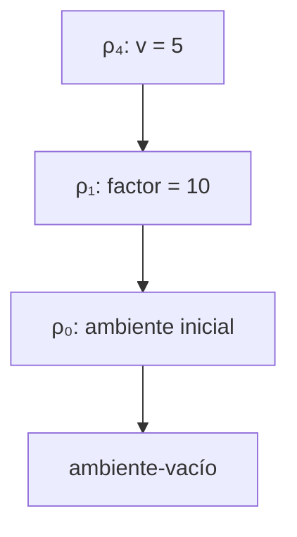
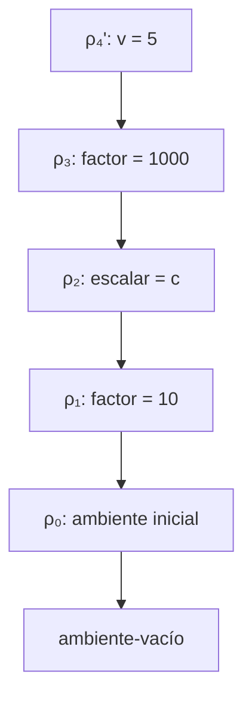

# Informe de corrección — Taller 2: El intérprete de Cauca

**Curso:** Fundamentos de Interpretación y Compilación de Lenguajes de Programación — Universidad del Valle, Sede Tuluá.

**Integrantes del grupo:**

| Nombre | Código | Correo institucional |
|---|---:|---|
| Nicolás Cardona García | 2477349 | nicolas.cardona.garcia@correounivalle.edu.co |
| Laura Sofía Echeverry González | 2477067 | echeverry.laura@correounivalle.edu.co |
| Santiago Serrano Morales | 2477006 | serrano.santiago@correounivalle.edu.co |
| Samuel Peña Jaramillo | 2477399 | samuel.pena.jaramillo@correounivalle.edu.co |

---

## 1. Marco formal

En esta sección se presentan los principios formales utilizados para analizar la corrección de las funciones del intérprete de Cauca. Se consideran las condiciones iniciales, las propiedades que deben mantenerse durante la ejecución y las condiciones que permiten establecer que el resultado obtenido es correcto.

### 1.1. Corrección de programas recursivos

La corrección de un programa recursivo se puede justificar mediante el principio de inducción. Para ello, se identifica un caso base que debe producir un resultado correcto y se demuestra que, si las llamadas recursivas realizadas sobre casos más pequeños son correctas, entonces la función también produce un resultado correcto para el caso actual.

El razonamiento se estructura de la siguiente manera:

1. **Caso base:** se verifica que la función resuelve correctamente el caso más sencillo, sin necesitar nuevas llamadas recursivas.
2. **Hipótesis inductiva:** se supone que la función es correcta para los casos más pequeños que el caso analizado.
3. **Paso inductivo:** se demuestra que, utilizando los resultados correctos de las llamadas recursivas, la función obtiene el resultado esperado para el caso actual.

Además de la corrección funcional, se debe considerar la terminación. Para justificarla, se identifica una medida que disminuya en cada llamada recursiva y que no pueda disminuir indefinidamente. Cuando esta condición se cumple y los casos base terminan, se puede concluir que la recursión finaliza.

En el intérprete de Cauca, este razonamiento permite analizar funciones que recorren estructuras, buscan identificadores en ambientes o procesan expresiones mediante llamadas recursivas.

### 1.2. Corrección de programas iterativos

La corrección de un programa iterativo puede demostrarse mediante un invariante de ciclo. Un invariante es una propiedad que se mantiene verdadera durante las iteraciones y que permite relacionar el estado del programa con el resultado esperado.

La demostración se organiza en tres etapas:

1. **Inicialización:** se comprueba que el invariante es verdadero antes de comenzar las iteraciones.
2. **Mantenimiento:** se demuestra que, si el invariante es verdadero al inicio de una iteración, continúa siendo verdadero después de ejecutar el cuerpo del ciclo.
3. **Terminación:** cuando el ciclo finaliza, se utiliza el invariante junto con la condición de salida para demostrar que el resultado obtenido satisface la especificación.

También se debe justificar que el ciclo termina. Para ello, puede utilizarse una variable o medida que avance hacia una condición de salida y que no permanezca indefinidamente en un estado que permita continuar iterando.

Aunque el análisis principal del intérprete de Cauca se centra en funciones recursivas, los principios de invariantes permiten razonar sobre cualquier procedimiento iterativo que forme parte de la implementación.

### 1.3. Alcance del análisis

El análisis de corrección se centra en las funciones del intérprete de Cauca que intervienen en la aplicación de procedimientos, la gestión de ambientes y la evaluación de expresiones de selección.

En particular, se consideran los siguientes componentes:

- **`apply-procedure`:** analiza la aplicación de procedimientos y la correspondencia entre los parámetros formales y los argumentos recibidos.
- **`letrec` y `apply-env`:** analiza la construcción de ambientes recursivos y la búsqueda de identificadores dentro de ellos.
- **`case-exp`:** analiza la evaluación de expresiones de selección y la ejecución de la alternativa correspondiente.

Para cada función se debe establecer una especificación, identificar las condiciones necesarias para su funcionamiento y justificar que su implementación cumple el comportamiento esperado.

La terminación se analiza de acuerdo con el comportamiento de cada función. Es importante distinguir entre la terminación de una operación específica del intérprete y la terminación de cualquier programa interpretado: un programa escrito en Cauca puede contener una recursión que no termine, por lo que no se debe asumir que todas las evaluaciones finalizan.

---

## 2. Funciones analizadas

En esta sección se analiza la corrección de tres componentes del intérprete de Cauca: la aplicación de procedimientos mediante `apply-procedure`, la definición y búsqueda de procedimientos recursivos mediante `letrec-exp` y `apply-env`, y la selección de alternativas mediante `case-exp` y `seleccionar-caso`.

Las demostraciones se basan en las implementaciones del intérprete compartidas por el grupo. Para cada componente se presenta su especificación, el código correspondiente, la demostración de corrección y el argumento de terminación.

### 2.1. Corrección de `apply-procedure`

#### Especificación formal

La función `apply-procedure` es responsable de aplicar una clausura, asociando los argumentos recibidos con los parámetros formales y evaluando el cuerpo del procedimiento en el ambiente de definición extendido con dichas ligaduras.

Su comportamiento debe satisfacer las siguientes propiedades:

1. La cantidad de argumentos debe coincidir con la cantidad de parámetros formales.
2. El cuerpo debe evaluarse en el ambiente de definición de la clausura, extendido con los parámetros y sus respectivos argumentos.
3. Si la cantidad de argumentos no coincide con la cantidad de parámetros, la aplicación debe generar un error.
4. Si el operador de una aplicación no es un procedimiento, también debe generarse un error.

**Especificación:**

- **Tipo:** `apply-procedure : procval × lista de valores → valor`.
- **Precondición:** `proc` debe ser una clausura válida que contenga una lista de parámetros formales, un cuerpo y un ambiente de definición. Los elementos de `args` deben ser valores previamente evaluados.
- **Postcondición:** si la cantidad de argumentos coincide con la cantidad de parámetros, se evalúa el cuerpo en el ambiente de definición extendido con las ligaduras de los parámetros. Si las cantidades son diferentes, se genera un error de aridad.

Sean:

- $X=(x_1,\ldots,x_n)$ la lista de parámetros formales.
- $\bar{v}=(v_1,\ldots,v_m)$ la lista de argumentos.
- $B$ el cuerpo del procedimiento.
- $\rho_d$ el ambiente de definición de la clausura.
- $\rho_b$ el ambiente en el que se evalúa el cuerpo.
- $r$ el resultado de la evaluación.

La postcondición se expresa formalmente como:

$$\mathrm{Post}(X,\bar{v},B,\rho_d,r)\equiv
\begin{cases}
r=\mathrm{value\text{-}of}(B,\mathrm{ext}(X,\bar{v},\rho_d)), & \text{si } |X|=|\bar{v}|,\\
r=\mathrm{error}, & \text{si } |X|\ne|\bar{v}|.
\end{cases}$$

La notación $\mathrm{ext}(X,\bar{v},\rho_d)$ representa el ambiente que asocia cada parámetro con su argumento y conserva como ambiente padre el ambiente de definición.

Por tanto, la condición fundamental de corrección es:

$$\rho_b=\mathrm{ext}(X,\bar{v},\rho_d)$$

Esta condición establece que el ambiente de definición, y no el ambiente de llamada, debe ser el ambiente padre de las ligaduras de los parámetros.

#### Implementación analizada

La función implementada en el intérprete es:

```racket
(define apply-procedure
  (lambda (proc args)
    (cases procval proc
      (cerradura (ids body env-definicion)
        (if (= (length ids) (length args))
            (evaluar-expresion
             body
             (ambiente-extendido ids args env-definicion))
            (eopl:error
             'apply-procedure
             "se esperaban ~s argumento(s) y llegaron ~s"
             (length ids)
             (length args)))))))
```

La implementación descompone la clausura y obtiene sus parámetros, su cuerpo y su ambiente de definición. Después compara la cantidad de parámetros con la cantidad de argumentos.

Si las cantidades coinciden, construye un ambiente extendido utilizando `env-definicion` como ambiente padre y evalúa el cuerpo en ese ambiente. Si las cantidades son diferentes, genera un error y no evalúa el cuerpo.

La instrucción fundamental es:

```racket
(ambiente-extendido ids args env-definicion)
```

El tercer argumento determina el ambiente padre de las nuevas ligaduras. Como se utiliza `env-definicion`, las variables libres del procedimiento se resuelven conforme al ambiente en el que fue definido.

#### Demostración de corrección respecto a la cantidad de argumentos

La demostración se realiza mediante un análisis de casos sobre la condición:

$$|X|=|\bar{v}|$$

**Caso 1: la cantidad de parámetros coincide con la cantidad de argumentos.**

Supongamos que:

$$|X|=|\bar{v}|$$

La condición del `if` es verdadera y se ejecuta:

```racket
(evaluar-expresion
 body
 (ambiente-extendido ids args env-definicion))
```

Por la construcción de `ambiente-extendido`, el ambiente utilizado para evaluar el cuerpo es:

$$\rho_b=\mathrm{ext}(X,\bar{v},\rho_d)$$

En consecuencia, el resultado de la aplicación es:

$$r=\mathrm{value\text{-}of}(B,\rho_b)$$

Sustituyendo la definición de $\rho_b$:

$$r=\mathrm{value\text{-}of}\left(B,\mathrm{ext}(X,\bar{v},\rho_d)\right)$$

Por tanto, se satisface la primera alternativa de la postcondición.

**Caso 2: la cantidad de parámetros es diferente de la cantidad de argumentos.**

Supongamos que:

$$|X|\neq|\bar{v}|$$

La condición del `if` es falsa y se ejecuta:

```racket
(eopl:error
 'apply-procedure
 "se esperaban ~s argumento(s) y llegaron ~s"
 (length ids)
 (length args))
```

La función genera un error explícito que informa cuántos argumentos se esperaban y cuántos se recibieron. El cuerpo del procedimiento no llega a evaluarse.

Por tanto, se satisface la segunda alternativa de la postcondición.

Ambos casos son mutuamente excluyentes y cubren todas las posibilidades de comparación entre las longitudes de las listas. En consecuencia, `apply-procedure` cumple la especificación respecto a la cantidad de argumentos.

#### Demostración del alcance léxico

El alcance léxico establece que las variables libres de un procedimiento se resuelven utilizando las ligaduras disponibles en el ambiente en el que fue definido el procedimiento, no las ligaduras locales del lugar desde el cual se invoca.

Para demostrar esta propiedad, se consideran dos lemas y un teorema.

**Lema 1. La clausura conserva el ambiente de definición.**

Cuando una expresión `proc-exp` se evalúa en un ambiente $\rho$, la implementación construye la clausura mediante:

```racket
(proc-exp (ids body)
  (cerradura ids body env))
```

Por tanto, si $X$ representa los parámetros y $B$ el cuerpo, la clausura resultante es:

$$c=\langle X,B,\rho\rangle$$

El tercer componente de la clausura es el ambiente en el que se evaluó la expresión `proc-exp`. El cuerpo todavía no se ejecuta.

Así, la clausura conserva el ambiente de definición. $\square$

**Lema 2. `apply-procedure` utiliza el ambiente capturado.**

La función `apply-procedure` recibe el procedimiento y los valores de sus argumentos. Al descomponer la clausura, obtiene el ambiente de definición en la variable `env-definicion`.

Cuando construye el ambiente del cuerpo, utiliza:

```racket
(ambiente-extendido ids args env-definicion)
```

Por tanto, el ambiente padre de las ligaduras de los parámetros es el ambiente capturado por la clausura. La función no utiliza el ambiente de llamada para construir dicho ambiente.

Así, el cuerpo se evalúa extendiendo el ambiente de definición. $\square$

**Teorema. El cuerpo de un procedimiento se evalúa en su ambiente de definición.**

Sea:

$$c=\langle X,B,\rho_d\rangle$$

una clausura aplicada desde un ambiente de llamada $\rho_{\mathrm{llamada}}$, con la cantidad correcta de argumentos $\bar{v}$.

Por los lemas anteriores, `apply-procedure` evalúa el cuerpo en:

$$\rho_b=\mathrm{ext}(X,\bar{v},\rho_d)$$

y no en:

$$\rho_b'=\mathrm{ext}(X,\bar{v},\rho_{\mathrm{llamada}})$$

Los argumentos se evalúan previamente en el ambiente de llamada, según la implementación de `app-exp`. Sin embargo, una vez obtenidos sus valores, estos se asocian con los parámetros utilizando el ambiente de definición como ambiente padre.

En consecuencia, la implementación cumple el comportamiento esperado del alcance léxico. $\square$

#### Ejemplo de contraste: resultados 50 y 5000

Considérese el siguiente programa de la Parte 3 del taller:

```text
let factor = 10
in
  let escalar = proc (v) *(v, factor) end
  in
    let factor = 1000
    in
      apply escalar (5)
    end
  end
end
```

El programa define `escalar` cuando `factor` vale $10$. Posteriormente, crea una nueva ligadura de `factor` con valor $1000$ y aplica `escalar` con argumento $5$.

Para analizar la evaluación, se definen los siguientes ambientes:

$$\rho_0=\text{ambiente inicial}$$

$$\rho_1=\mathrm{ext}((factor),(10),\rho_0)$$

La clausura de `escalar` se construye en $\rho_1$:

$$c=\langle(v),*(v,factor),\rho_1\rangle$$

Después se crea la ligadura de `escalar`:

$$\rho_2=\mathrm{ext}((escalar),(c),\rho_1)$$

La nueva declaración de `factor` produce:

$$\rho_3=\mathrm{ext}((factor),(1000),\rho_2)$$

La aplicación `apply escalar (5)` ocurre en $\rho_3$. En ese ambiente, `escalar` se encuentra mediante la búsqueda en los ambientes padres y el argumento se evalúa con el valor $5$.

**Evaluación correcta: ambiente de definición.**

La implementación de `apply-procedure` utiliza $\rho_1$, el ambiente capturado por la clausura, como ambiente padre del parámetro `v`.

Por tanto, el ambiente del cuerpo es:

$$\rho_4=\mathrm{ext}((v),(5),\rho_1)$$

Al buscar `factor`, el intérprete no lo encuentra en $\rho_4$, por lo que continúa en $\rho_1$. Allí encuentra la ligadura original:

$$factor=10$$

La evaluación del cuerpo es:

$$*(v,factor)=5\cdot10=50$$

El resultado correcto es:

$$\boxed{50}$$

La cadena de ambientes correspondiente es:



En esta cadena, $\rho_4$ contiene el parámetro y apunta al ambiente de definición $\rho_1$. La búsqueda de `factor` encuentra el valor $10$ en dicho ambiente.

**Evaluación incorrecta: ambiente de llamada.**

Si se utilizara incorrectamente el ambiente de llamada como ambiente padre, se construiría:

$$\rho_4'=\mathrm{ext}((v),(5),\rho_3)$$

Al buscar `factor`, el intérprete encontraría primero la ligadura más reciente:

$$factor=1000$$

En consecuencia, la evaluación sería:

$$*(v,factor)=5\cdot1000=5000$$

El resultado sería:

$$\boxed{5000}$$

La cadena de ambientes correspondiente a esta evaluación incorrecta es:



En esta cadena, la búsqueda de `factor` encuentra el valor $1000$ en $\rho_3$ antes de llegar a $\rho_1$.

La comparación de ambos resultados es:

| Estrategia | Ambiente padre del cuerpo | Valor de `factor` | Resultado |
|---|---|---:|---:|
| Alcance léxico, implementado | $\rho_1$ | 10 | 50 |
| Ambiente de llamada, incorrecto | $\rho_3$ | 1000 | 5000 |

Este ejemplo demuestra que el ambiente padre utilizado al aplicar una clausura modifica el resultado cuando existen ligaduras con el mismo identificador en diferentes niveles.

La implementación es correcta porque conserva el ambiente de definición y produce $50$, tal como exige el alcance léxico de Cauca.

#### Corrección del tratamiento de errores

La aplicación de procedimientos involucra dos verificaciones: comprobar que el operador sea un procedimiento y comprobar que la cantidad de argumentos coincida con la cantidad de parámetros.

La primera verificación se encuentra en la variante `app-exp` de `evaluar-expresion`:

```racket
(app-exp (rator rands)
  (let ((proc (evaluar-expresion rator env)))
    (if (procval? proc)
        (let ((args (evaluar-rands rands env)))
          (apply-procedure proc args))
        (eopl:error
         'app-exp
         "el operador no es un procedimiento: ~s"
         proc)))
```

La implementación evalúa primero el operador y verifica su tipo mediante `procval?`.

**Caso 1: el operador no es un procedimiento.**

Si el resultado de evaluar `rator` no satisface `procval?`, la condición es falsa y se ejecuta `eopl:error`. En este caso, la función no evalúa los argumentos ni invoca `apply-procedure`.

Por tanto, la aplicación genera un error porque el operador no representa un procedimiento.

**Caso 2: el operador es un procedimiento, pero la cantidad de argumentos es incorrecta.**

Si el operador es una clausura, `app-exp` evalúa los argumentos y llama a `apply-procedure`. Si la cantidad de argumentos no coincide con la cantidad de parámetros, la condición del `if` dentro de `apply-procedure` es falsa y se genera el error de aridad demostrado en la sección 2.1.3.

**Caso 3: el operador es un procedimiento y la cantidad de argumentos es correcta.**

En este caso, `app-exp` invoca `apply-procedure`, que construye el ambiente del cuerpo y evalúa el procedimiento conforme a la especificación.

Los casos anteriores muestran que las dos verificaciones de la aplicación están implementadas en los lugares correspondientes:

| Condición | Función responsable | Comportamiento |
|---|---|---|
| El operador no es un procedimiento | `app-exp` | Genera un error de operador no procedimental. |
| La cantidad de argumentos no coincide | `apply-procedure` | Genera un error de aridad. |
| El operador es un procedimiento y la aridad coincide | `apply-procedure` | Evalúa el cuerpo en el ambiente de definición extendido. |

Esta afirmación se refiere a los errores de validación propios de la aplicación. Durante la evaluación de los argumentos o del cuerpo también pueden producirse errores por otras causas.

Por tanto, la implementación verifica correctamente que el operador sea un procedimiento y que la cantidad de argumentos coincida con la cantidad de parámetros antes de completar la aplicación.

#### Terminación

`apply-procedure` no contiene llamadas recursivas directas. Comprueba la longitud de las listas de parámetros y argumentos y, posteriormente, evalúa el cuerpo o genera un error.

Sin embargo, cuando las cantidades coinciden, la terminación de la aplicación depende de la evaluación del cuerpo. Si este contiene llamadas recursivas que no terminan, tampoco puede garantizarse que la aplicación completa finalice.

Por tanto, puede garantizarse que `apply-procedure` realiza la comprobación de aridad y selecciona la operación correspondiente, pero no que cualquier procedimiento aplicado termine independientemente de su cuerpo.

#### Conclusión

La implementación de `apply-procedure` cumple la especificación establecida para la aplicación de clausuras. Verifica que la cantidad de argumentos coincida con la cantidad de parámetros y evalúa el cuerpo en el ambiente de definición extendido con las ligaduras correspondientes.

La combinación de `proc-exp`, `app-exp` y `apply-procedure` también garantiza que la aplicación valide el tipo del operador y la aridad. La demostración formal confirma que el ambiente capturado por la clausura se conserva durante la ejecución del procedimiento.

Finalmente, el ejemplo de contraste demuestra la importancia del alcance léxico: el programa produce $50$ cuando se utiliza correctamente el ambiente de definición, mientras que el uso incorrecto del ambiente de llamada produciría $5000$. Por tanto, la implementación analizada respeta el comportamiento esperado para la aplicación de procedimientos en Cauca.

---

### 2.2. Corrección de la ligadura recursiva (`letrec` y `apply-env`)

#### Invariante del ambiente recursivo

La implementación de `letrec` debe garantizar que cada procedimiento declarado pueda acceder a su propio nombre y a los demás procedimientos definidos en el mismo bloque recursivo. Para ello, si el ambiente recursivo se representa como:

$$\rho_r=\mathrm{rec}(F,\bar X,\bar B,\rho)$$

donde $F$ contiene los nombres de los procedimientos, $\bar X$ sus parámetros, $\bar B$ sus cuerpos y $\rho$ el ambiente exterior, se establece el siguiente invariante:

$$\mathrm{buscar}(\rho_r,f_i)=\langle X_i,B_i,\rho_r\rangle$$

Esto significa que cada procedimiento debe resolverse a una clausura que conserve sus parámetros, su cuerpo y el propio ambiente recursivo.

#### Construcción de clausuras mediante `apply-env`

La implementación de `letrec-exp` crea el ambiente recursivo y evalúa en él la expresión que contiene:

    (let ((env-rec
           (ambiente-recursivo proc-names idss bodies env)))
      (evaluar-expresion body env-rec))

Por su parte, cuando `apply-env` encuentra un procedimiento dentro de un `ambiente-recursivo`, construye la clausura de la siguiente manera:

    (cerradura (list-ref idss pos)
               (list-ref bodies pos)
               env)

El último argumento es el propio ambiente recursivo consultado. Por tanto, la clausura conserva el entorno en el que están disponibles los procedimientos declarados.

**Demostración:** al buscar el nombre de un procedimiento, `apply-env` identifica su posición en la lista `proc-names`. Con esa posición obtiene sus parámetros y su cuerpo, y construye una clausura que captura el ambiente recursivo. Cuando se invoca el procedimiento, sus argumentos se asocian con los parámetros y el cuerpo se evalúa en un ambiente extendido cuyo padre es el ambiente recursivo. Así, las referencias al propio procedimiento y a los demás procedimientos del bloque pueden resolverse correctamente. Por tanto, se satisface el invariante establecido.

#### Demostración del invariante del ambiente recursivo

Sea el ambiente recursivo:

$$\rho_r=\mathrm{rec}(F,\bar X,\bar B,\rho)$$

donde $F=(f_1,\ldots,f_n)$ representa los nombres de los procedimientos, $\bar X=(X_1,\ldots,X_n)$ sus listas de parámetros, $\bar B=(B_1,\ldots,B_n)$ sus cuerpos y $\rho$ el ambiente exterior.

El invariante que se desea demostrar establece que, para cada procedimiento $f_i$ declarado en el ambiente recursivo, su búsqueda debe producir una clausura que contenga sus parámetros, su cuerpo y el propio ambiente recursivo:

$$\mathrm{apply\text{-}env}(\rho_r,f_i)=\mathrm{cerradura}(X_i,B_i,\rho_r)$$

**Demostración:**

1. **Búsqueda del procedimiento:** cuando `apply-env` recibe el ambiente $\rho_r$ y el identificador $f_i$, identifica la posición $i$ del procedimiento en la lista de nombres $F$. Si el procedimiento existe en dicha lista, no continúa buscando en el ambiente exterior.

2. **Obtención de los componentes:** mediante la posición encontrada, la implementación recupera la lista de parámetros $X_i$ y el cuerpo $B_i$ del procedimiento utilizando `list-ref`.

3. **Construcción de la clausura:** la implementación ejecuta:

   ```racket
   (cerradura (list-ref idss pos)
              (list-ref bodies pos)
              env)
   ```

   En esta expresión, `env` corresponde al ambiente recursivo que se está consultando. Por tanto, la clausura resultante conserva los parámetros y el cuerpo del procedimiento, además de capturar el propio ambiente recursivo.

4. **Verificación del invariante:** al invocarse la clausura, los argumentos recibidos se asocian con sus parámetros y el cuerpo se evalúa en un ambiente extendido cuyo ambiente padre es el ambiente capturado. Como este ambiente padre es $\rho_r$, las referencias al propio procedimiento y a los demás procedimientos declarados en el mismo bloque pueden resolverse mediante `apply-env`.

Por consiguiente, para cada procedimiento $f_i$ perteneciente al ambiente recursivo, se cumple:

$$\mathrm{apply\text{-}env}(\rho_r,f_i)=\mathrm{cerradura}(X_i,B_i,\rho_r)$$

Así, la implementación satisface el invariante de ligadura recursiva: cada procedimiento conserva el ambiente necesario para resolver sus propias llamadas recursivas y las referencias a los demás procedimientos del bloque.

#### ¿Por qué `let` no es suficiente?

Una declaración equivalente mediante `let` no garantiza la recursión, porque la clausura captura el ambiente disponible durante su definición, antes de que el nombre del procedimiento esté ligado al procedimiento mismo.

Por ejemplo:

    let potencia = proc (base, exp)
      if ==(exp, 0)
      then 1
      else *(base, apply potencia (base, sub1(exp)))
      end
    in
      apply potencia (2, 10)
    end

En esta declaración, `potencia` no está disponible en el ambiente capturado por su propia clausura. Por ello, al intentar realizar la llamada recursiva, el intérprete produce un error de variable no ligada, como `Variable no ligada: potencia`.

En cambio, `letrec` utiliza un ambiente recursivo que permite resolver el nombre del procedimiento durante su ejecución.

#### Terminación del procedimiento `potencia`

El taller propone el siguiente procedimiento:

    letrec
      potencia (base, exp) =
        if ==(exp, 0)
        then 1
        else *(base, apply potencia (base, sub1(exp)))
        end
    in
      apply potencia (2, 10)
    end

Para demostrar su terminación, se toma como medida el exponente $exp$, suponiendo que es un entero no negativo.

- **Caso base:** cuando $exp=0$, el procedimiento devuelve `1` y termina sin realizar otra llamada recursiva.
- **Caso recursivo:** cuando $exp>0$, se realiza una llamada con `sub1(exp)`, por lo que la medida disminuye en una unidad.

Como el exponente es un entero no negativo y disminuye estrictamente en cada llamada, necesariamente se alcanza el caso base. Por tanto, el procedimiento termina y calcula la potencia solicitada. Para el ejemplo del taller, el resultado de $2^{10}$ es `1024`.

#### Verificación mediante pruebas

Se realizaron pruebas directamente en DrRacket para comprobar el funcionamiento de la ligadura recursiva:

- **Recursión simple:** el factorial de 6 produjo el resultado `720`.
- **Recursión mutua:** los procedimientos `par?` e `impar?` pudieron invocarse entre sí y determinar correctamente que `par?(9)` devuelve `#f`.
- **Caso base:** el factorial de cero devolvió `1`.
- **Potencia con exponente cero:** el procedimiento `potencia` devolvió `1` para la expresión `potencia(7, 0)`.
- **Selección de alternativas:** la expresión `case 3 of 1 => 100 of 3 => 300 otherwise => 0 end` devolvió `300`.
- **Rama por defecto:** una expresión `case` sin coincidencias ejecutó la rama `otherwise` y devolvió `99`.

Los resultados obtenidos confirman que el ambiente recursivo permite resolver las referencias entre procedimientos y que las condiciones de parada funcionan correctamente en los casos evaluados. Asimismo, las pruebas de `case` verifican la selección de alternativas y la ejecución de la rama por defecto.

### Conclusión

La corrección de la ligadura recursiva consiste en garantizar que cada procedimiento definido mediante `letrec` pueda acceder a su propio nombre y a los demás procedimientos del bloque recursivo. Esto se consigue mediante la construcción de un ambiente recursivo y la creación de clausuras que conservan dicho ambiente. A diferencia de `let`, esta implementación permite resolver correctamente las llamadas recursivas. Además, en el procedimiento `potencia`, la disminución del exponente en cada llamada garantiza la llegada al caso base para exponentes enteros no negativos, asegurando la terminación del procedimiento.

---

### 2.3 Corrección de `case-exp` y `seleccionar-caso`

#### Especificación

La función `seleccionar-caso` es responsable de buscar la primera alternativa cuyo valor coincida con el valor de control. Si encuentra una coincidencia, evalúa la acción correspondiente; si no quedan alternativas, evalúa la expresión predeterminada.

Por su parte, la variante `case-exp` de `evaluar-expresion` evalúa la expresión de control, comprueba que su resultado sea numérico y delega la selección de alternativas en `seleccionar-caso`.

- **Tipo de `seleccionar-caso`:** número × lista de números × lista de expresiones × expresión predeterminada × ambiente → valor.
- **Tipo de `case-exp`:** expresión de control, primer valor, primera acción, valores restantes, acciones restantes, acción predeterminada y ambiente → valor.
- **Precondición:** la expresión de control debe evaluarse a un número. Además, las listas de valores y acciones deben conservar la correspondencia entre cada alternativa y su acción, y tener la misma longitud.
- **Postcondición:** se evalúa la acción correspondiente a la primera alternativa cuyo valor coincide con el control. Si ninguna alternativa coincide, se evalúa la acción predeterminada. Si el control no es numérico, se genera un error.

Sean $v$ el valor del control, $c_1,\ldots,c_n$ los valores de las alternativas, $A_1,\ldots,A_n$ sus acciones, $D$ la acción predeterminada y $\rho$ el ambiente de evaluación.

La especificación de la selección se expresa formalmente como:

$$\mathrm{resultado}(v)=\begin{cases}\mathrm{value\text{-}of}(A_i,\rho), & \text{si } i=\min\{j\mid c_j=v\},\\\mathrm{value\text{-}of}(D,\rho), & \text{si no existe tal } i.\end{cases}$$

La expresión de control se evalúa una sola vez, antes de iniciar la búsqueda de alternativas. La función debe conservar el orden original de las alternativas para garantizar que se seleccione la primera coincidencia.

#### Código de `seleccionar-caso`

```racket
;; seleccionar-caso : numero x lista de numeros x lista de expresiones
;;                    x expresion x ambiente -> valor
;; Busca la primera alternativa cuyo valor coincide con el control.
;; Si ninguna coincide, evalua la expresion predeterminada.

(define seleccionar-caso
  (lambda (control valores acciones default env)
    (cond
      [(null? valores)
       (evaluar-expresion default env)]
      [(= control (car valores))
       (evaluar-expresion (car acciones) env)]
      [else
       (seleccionar-caso
        control
        (cdr valores)
        (cdr acciones)
        default
        env)])))
```

La función recibe el valor de control, las listas de valores y acciones, la expresión predeterminada y el ambiente de evaluación.

Su comportamiento se divide en tres posibilidades:

1. **Lista de valores vacía:** cuando no quedan alternativas por revisar, evalúa la expresión predeterminada en el ambiente recibido.
2. **Coincidencia:** cuando el control coincide con el primer valor de la lista, evalúa la primera acción correspondiente y devuelve su resultado.
3. **Ausencia de coincidencia inicial:** cuando el control no coincide con el primer valor, realiza una llamada recursiva con las listas restantes, conservando el control, la expresión predeterminada y el ambiente.

La función mantiene la correspondencia entre valores y acciones al eliminar simultáneamente el primer elemento de ambas listas. Esto permite que cada alternativa conserve su acción asociada durante toda la búsqueda.

La implementación presupone que ambas listas tienen la misma longitud. Si esta condición se cumple, cada comparación dispone de una acción correspondiente y la selección puede realizarse correctamente.

#### Código de `case-exp`

La variante `case-exp` de `evaluar-expresion` es:

```racket
;; Parte 4: seleccion de alternativas mediante case.
(case-exp (exp primer-valor primera-accion valores acciones default)
  (let ((control (evaluar-expresion exp env)))
    (if (number? control)
        (seleccionar-caso
         control
         (cons primer-valor valores)
         (cons primera-accion acciones)
         default
         env)
        (eopl:error
         'case-exp
         "El valor de control debe ser numerico: ~s"
         control)))
```

La implementación evalúa primero la expresión de control y almacena su resultado en la variable `control`. Esta evaluación se realiza una sola vez.

Si el resultado es numérico, la función construye las listas completas de alternativas mediante `cons`. El primer valor se incorpora a la lista `valores` y la primera acción se incorpora a la lista `acciones`. Después, delega la búsqueda en `seleccionar-caso`.

Si el resultado no es numérico, la función genera un error explícito mediante `eopl:error` y no ejecuta la búsqueda de alternativas.

La construcción con `cons` es importante porque la representación de `case-exp` separa la primera alternativa de las alternativas restantes. Al incorporarlas a sus respectivas listas, `seleccionar-caso` puede procesarlas en el orden original sin distinguir entre la primera alternativa y las demás.

#### Estrategia de demostración

La corrección de `seleccionar-caso` se demuestra mediante inducción estructural sobre la lista de valores de las alternativas. Se consideran el caso base, en el que la lista está vacía, y el caso inductivo, en el que existe al menos una alternativa.

Para `case-exp`, se realiza un análisis de casos sobre el resultado de evaluar la expresión de control: un caso para los valores numéricos y otro para los valores no numéricos.

La demostración supone que las listas de valores y acciones tienen la misma longitud, que cada valor corresponde a su acción y que las evaluaciones involucradas producen resultados cuando se necesitan. Estas condiciones permiten analizar la selección sin introducir errores ajenos a la función estudiada.

#### Demostración de `seleccionar-caso`

**Caso base: no quedan alternativas.**

Supongamos que la lista de valores está vacía:

$$C=[]$$

En este caso, se cumple la primera condición del `cond`:

```racket
[(null? valores)
 (evaluar-expresion default env)]
```

Por tanto, la función evalúa la expresión predeterminada en el ambiente $\rho$:

$$r=\mathrm{value\text{-}of}(D,\rho)$$

Como no quedan alternativas, no existe ningún valor que pueda coincidir con el control. En consecuencia, evaluar la expresión predeterminada satisface la especificación.

**Caso inductivo: existe al menos una alternativa.**

Supongamos que la lista de valores es:

$$C=(c_1,c_2,\ldots,c_n)$$

y que la lista de acciones correspondiente es:

$$A=(A_1,A_2,\ldots,A_n)$$

Se consideran dos posibilidades.

**Subcaso A: el control coincide con la primera alternativa.**

Si:

$$v=c_1$$

se ejecuta la segunda condición del `cond`:

```racket
[(= control (car valores))
 (evaluar-expresion (car acciones) env)]
```

La función evalúa la primera acción $A_1$ en el ambiente $\rho$ y devuelve:

$$r=\mathrm{value\text{-}of}(A_1,\rho)$$

Como $c_1$ es el primer valor de la lista y coincide con $v$, ninguna alternativa anterior puede coincidir. Por tanto, la función selecciona correctamente la primera alternativa coincidente.

**Subcaso B: el control no coincide con la primera alternativa.**

Si:

$$v\neq c_1$$

se ejecuta la llamada recursiva:

```racket
(seleccionar-caso
 control
 (cdr valores)
 (cdr acciones)
 default
 env)
```

La función elimina el primer valor y la primera acción y continúa la búsqueda sobre las listas restantes.

**Hipótesis inductiva:** supongamos que `seleccionar-caso` funciona correctamente para las listas restantes, cuya longitud es menor que la de las listas originales. Esto significa que devuelve la acción correspondiente a la primera coincidencia entre las alternativas restantes o evalúa la acción predeterminada si no encuentra ninguna.

Como $v\neq c_1$, la primera alternativa no puede ser la seleccionada. Por tanto, si existe una coincidencia en las listas restantes, la primera coincidencia de dichas listas también es la primera coincidencia de la lista original.

Si no existe ninguna coincidencia en las listas restantes, tampoco existe una coincidencia en la lista original, porque se sabe que la primera alternativa no coincide. En consecuencia, evaluar la expresión predeterminada es correcto.

Por la hipótesis inductiva, la llamada recursiva devuelve el resultado especificado.

Los dos subcasos cubren todas las posibilidades para una lista no vacía. Junto con el caso base, demuestran que `seleccionar-caso` devuelve la acción correspondiente a la primera coincidencia o, si no existe ninguna, evalúa la acción predeterminada.

Por tanto, la función satisface la especificación establecida.

#### Demostración de `case-exp`

La corrección de `case-exp` se demuestra mediante un análisis de casos sobre el resultado de evaluar la expresión de control.

**Caso 1: la expresión de control produce un número.**

Sea:

$$v=\mathrm{value\text{-}of}(exp,\rho)$$

Si:

$$\mathrm{number?}(v)=\mathrm{true}$$

la implementación llama a `seleccionar-caso` con las listas completas de valores y acciones, construidas mediante `cons`:

```racket
(seleccionar-caso
 control
 (cons primer-valor valores)
 (cons primera-accion acciones)
 default
 env)
```

Como las listas conservan el orden original y mantienen la correspondencia entre cada valor y su acción, la llamada recibe todas las alternativas del `case-exp`.

Por la demostración anterior, `seleccionar-caso` devuelve el resultado de evaluar la acción correspondiente a la primera coincidencia o evalúa la acción predeterminada si ninguna alternativa coincide.

Además, como `control` se obtiene mediante una única llamada a `evaluar-expresion`, la expresión de control se evalúa una sola vez.

Por tanto, `case-exp` satisface la especificación cuando el control es numérico.

**Caso 2: la expresión de control no produce un número.**

Si:

$$\mathrm{number?}(v)=\mathrm{false}$$

se ejecuta la rama alternativa del `if`:

```racket
(eopl:error
 'case-exp
 "El valor de control debe ser numerico: ~s"
 control)
```

La función genera un error explícito y no invoca `seleccionar-caso`.

Por tanto, la implementación rechaza los valores de control no numéricos, tal como establece la especificación.

Los dos casos cubren todas las posibilidades contempladas por la implementación. En consecuencia, `case-exp` satisface la especificación bajo las precondiciones establecidas.

#### Terminación

Para demostrar la terminación de `seleccionar-caso`, se utiliza como medida la longitud de la lista de valores que quedan por revisar:

$$\mu(C)=|C|$$

Esta medida pertenece al conjunto de los números naturales:

$$\mu(C)\in\mathbb{N}$$

**Caso base:** cuando la lista está vacía:

$$\mu(C)=0$$

la función evalúa la expresión predeterminada y no realiza otra llamada recursiva.

**Caso inductivo:** cuando la lista no está vacía y el control no coincide con el primer valor, la función realiza una llamada recursiva sobre `(cdr valores)`. En consecuencia, la medida disminuye estrictamente:

$$\mu(\mathrm{cdr}(C))=\mu(C)-1$$

Como la medida es un número natural y disminuye en cada llamada recursiva, no puede disminuir indefinidamente. La búsqueda necesariamente llega a una coincidencia o al caso base de la lista vacía.

Por tanto, la búsqueda de alternativas termina, siempre que las operaciones de comparación y las evaluaciones que se ejecutan también terminen.

En el caso de `case-exp`, la terminación completa depende además de que termine la evaluación de la expresión de control y de que termine la acción seleccionada o la acción predeterminada. La función no garantiza la terminación de expresiones arbitrarias que puedan evaluarse durante el proceso.

#### Conclusión

La implementación de `seleccionar-caso` es correcta respecto a la selección de la primera alternativa coincidente y a la evaluación de la expresión predeterminada cuando no existe ninguna coincidencia. La demostración inductiva establece que la búsqueda conserva el orden de las alternativas y la correspondencia entre sus valores y acciones.

Por su parte, `case-exp` evalúa la expresión de control una sola vez, verifica que el resultado sea numérico y construye las listas completas de alternativas antes de delegar la selección. Si el control no es numérico, genera un error explícito.

Finalmente, la medida basada en la longitud de la lista demuestra que la búsqueda recursiva de alternativas termina. En conjunto, ambas funciones cumplen la especificación establecida, siempre que se satisfagan las precondiciones y terminen las expresiones evaluadas.

---

## 3. Propiedades adicionales

### 3.1. Resolución de ligaduras y shadowing

La función `apply-env`, definida en el módulo `ambiente.rkt`, permite consultar el valor asociado a un identificador dentro de la cadena de ambientes. Su implementación utiliza `posicion-de` para determinar si el identificador está presente en el ambiente actual. Si lo encuentra, devuelve el valor correspondiente mediante `list-ref`; de lo contrario, continúa la búsqueda en el ambiente padre mediante una llamada recursiva a `apply-env`.

Este comportamiento garantiza que, cuando un identificador tiene varias ligaduras en distintos niveles de anidamiento, prevalezca la más cercana al punto de evaluación. Esta propiedad se conoce como *shadowing*.

Considérense los siguientes ambientes:

$$\rho_1 = \mathrm{ext}((x),(10),\rho_0)$$

$$\rho_2 = \mathrm{ext}((x),(20),\rho_1)$$

Al consultar el identificador $x$ en $\rho_2$, se obtiene:

$$\mathrm{apply\text{-}env}(\rho_2,x)=20$$

La búsqueda encuentra $x$ en el ambiente actual $\rho_2$ y devuelve el valor $20$, sin continuar hacia el ambiente padre $\rho_1$, donde el mismo identificador está asociado con el valor $10$.

La implementación también contempla el caso en que un identificador no se encuentra en ninguno de los ambientes de la cadena. Cuando la búsqueda alcanza `ambiente-vacio`, `apply-env` genera un error indicando que la variable no está ligada.

Por tanto, el código de `apply-env` implementa correctamente la resolución de ligaduras y el *shadowing*: las ligaduras más cercanas tienen prioridad sobre las más externas, y las variables no definidas producen un error.

### 3.2. Alcance léxico de los procedimientos

La implementación de los procedimientos en los módulos `interprete.rkt` y `ambiente.rkt` respeta el alcance léxico mediante el uso de clausuras. Una clausura almacena los parámetros del procedimiento, su cuerpo y el ambiente en el que fue definido.

En `interprete.rkt`, la expresión `proc-exp` construye una clausura con el ambiente actual:

```racket
(proc-exp (ids body)
  (cerradura ids body env))
```

De esta manera, el procedimiento conserva las ligaduras disponibles en el momento de su definición, sin evaluar anticipadamente el cuerpo.

Posteriormente, cuando se aplica el procedimiento, `apply-procedure` recupera los parámetros, el cuerpo y el ambiente de definición almacenado en la clausura. Si la cantidad de argumentos coincide con la cantidad de parámetros, extiende el ambiente de definición con las nuevas ligaduras y evalúa el cuerpo en el ambiente resultante:

```racket
(define apply-procedure
  (lambda (proc args)
    (cases procval proc
      (cerradura (ids body env-definicion)
        (if (= (length ids) (length args))
            (evaluar-expresion
             body
             (ambiente-extendido ids args env-definicion))
            (eopl:error
             'apply-procedure
             "se esperaban ~s argumento(s) y llegaron ~s"
             (length ids)
             (length args)))))))
```

El aspecto fundamental es que la extensión se realiza sobre `env-definicion`, no sobre el ambiente desde el cual se invoca el procedimiento. Esto evita que las ligaduras locales del lugar de llamada alteren el significado de las variables libres del cuerpo.

Por ejemplo, considérese el siguiente programa:

```text
let
  x = 10
in
  let
    f = proc() x end
  in
    let
      x = 20
    in
      apply f()
    end
  end
end
```

El resultado esperado es:

$$10$$

La razón es que `f` se definió cuando $x=10$. Aunque posteriormente se introduce otra ligadura de $x$ con valor $20$, esta pertenece al ambiente de llamada y no reemplaza la ligadura conservada por la clausura.

En consecuencia, la implementación distingue correctamente entre el ambiente de definición y el ambiente de llamada, garantizando el alcance léxico de los procedimientos.

### 3.3. Evaluación única de la expresión de control en `case`

La implementación de `case-exp`, definida en `interprete.rkt`, evalúa la expresión de control una sola vez mediante un `let` que almacena su resultado en la variable `control`. A continuación, comprueba que dicho resultado sea numérico y, si cumple esta condición, invoca a `seleccionar-caso` para buscar la alternativa correspondiente.

La estructura implementada es la siguiente:

```racket
(case-exp (exp primer-valor primera-accion valores acciones default)
  (let ((control (evaluar-expresion exp env)))
    (if (number? control)
        (seleccionar-caso control (cons primer-valor valores) (cons primera-accion acciones) default env)
        (eopl:error
         'case-exp
         "El valor de control debe ser numerico: ~s"
         control))))
```

La función `seleccionar-caso` recibe el valor de control ya calculado, la lista de valores que se deben comparar, la lista de acciones asociadas, la expresión predeterminada y el ambiente de evaluación.

Su comportamiento puede describirse mediante los siguientes casos:

- **Lista de alternativas vacía:** cuando no quedan valores por comparar, evalúa la expresión `default` en el ambiente recibido.
- **Coincidencia:** cuando `control` es igual al primer valor de la lista, evalúa la primera acción y devuelve su resultado, sin examinar las alternativas restantes.
- **Ausencia de coincidencia en la alternativa actual:** elimina el primer valor y su acción correspondiente, y continúa la búsqueda con las listas restantes.

La implementación de `seleccionar-caso` es:

```racket
(define seleccionar-caso
  (lambda (control valores acciones default env)
    (cond
      [(null? valores)
       (evaluar-expresion default env)]
      [(= control (car valores))
       (evaluar-expresion (car acciones) env)]
      [else
       (seleccionar-caso control (cdr valores) (cdr acciones) default env)])))
```

En esta función, los valores y las acciones se recorren en paralelo, conservando la correspondencia entre cada alternativa y su acción. La gramática de `case-exp` establece una primera pareja de valor y acción, seguida de cero o más parejas adicionales, por lo que las listas se construyen a partir de una alternativa inicial y sus respectivas continuaciones.

La evaluación única de la expresión de control se garantiza porque `evaluar-expresion` aparece una sola vez para dicha expresión, antes de iniciar la búsqueda. Las comparaciones posteriores utilizan el valor almacenado en `control`, en lugar de volver a evaluar la expresión original.

Además, la implementación establece que el valor de control debe ser numérico. Si no lo es, se genera un error mediante `eopl:error` y no se ejecuta la selección de alternativas.

Por tanto, el código implementa una selección ordenada: evalúa únicamente la acción asociada con la primera coincidencia, utiliza la expresión predeterminada cuando no encuentra ninguna coincidencia y evita repetir la evaluación de la expresión de control.

---

## 4. Referencias

- Friedman, D. P., y Wand, M. *Essentials of Programming Languages*. 3.ª edición. MIT Press, 2008. Secciones relacionadas con especificación inductiva, ambientes, procedimientos, clausuras y procedimientos recursivos.
- Racket Documentation. *The Racket Guide* y documentación del lenguaje `eopl`.
- Racket Documentation. *RackUnit: Unit Testing*: <https://docs.racket-lang.org/rackunit/>.
