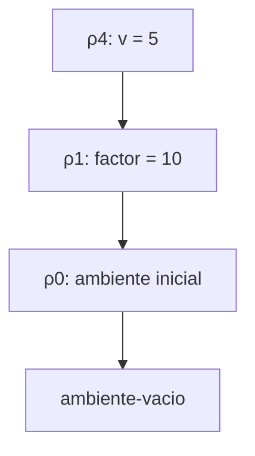
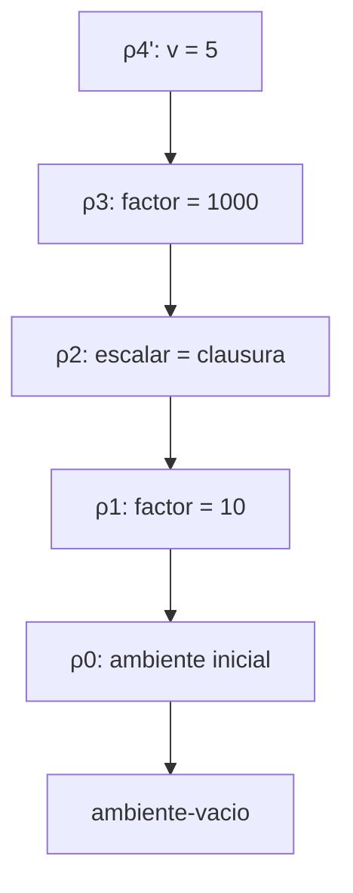
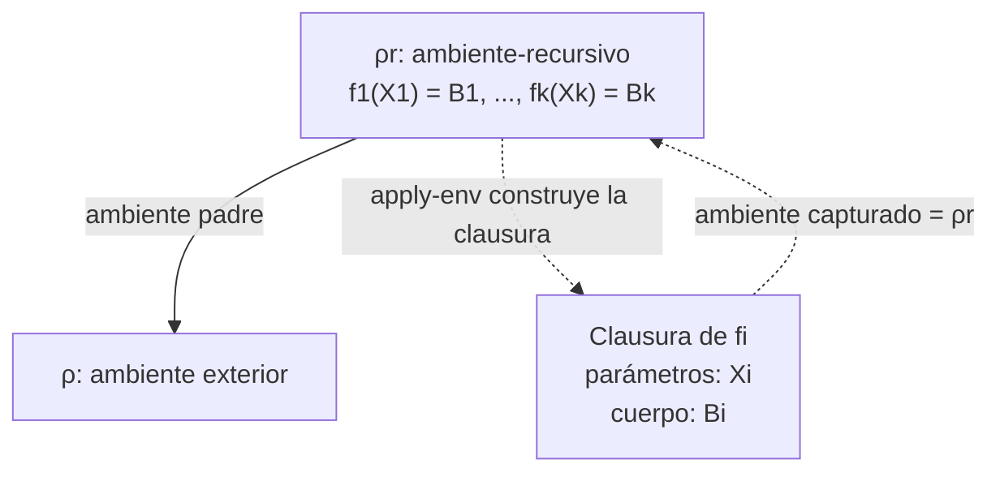

# Informe de corrección — Taller 2: El intérprete de Cauca

**Curso:** Fundamentos de Interpretación y Compilación de Lenguajes de Programación — Universidad del Valle, Sede Tuluá.

**Integrantes del grupo:**

| Nombre | Código | Correo institucional |
|---|---:|---|
| Nicolás Cardona García | 2477349 | nicolas.cardona.garcia@correounivalle.edu.co |
| Laura Sofía Echeverry González | 2477067 | echeverry.laura@correounivalle.edu.co |
| Santiago Serrano Morales | 2477006 | serrano.santiago@correounivalle.edu.co |
| Samuel Peña Jaramillo | 2477399 | samuel.pena.jaramillo@correounivalle.edu.co |

---

## 1. Marco formal

### 1.1. Corrección de programas recursivos

Sea $f:A\rightarrow B$ una función y sea $P_f$ un programa que pretende calcularla. Decimos que $P_f$ es correcto respecto a su especificación cuando, para toda entrada válida, termina y produce el resultado definido por $f$:

$$
\forall a\in A,\qquad P_f(a)=f(a)
$$

La corrección se demuestra mediante inducción sobre la estructura de los datos o sobre una medida natural que disminuya en cada llamada recursiva.

La demostración consta de dos partes:

- **Caso base:** se verifica que el programa produce el resultado especificado para la entrada mínima.
- **Caso inductivo:** se supone que el programa es correcto para entradas menores y se demuestra que también lo es para la entrada actual.

La demostración de corrección del resultado no implica automáticamente la terminación. Por ello, cuando una función es recursiva, también se debe identificar una medida que disminuya estrictamente en cada llamada y que esté acotada inferiormente.

### 1.2. Corrección de programas iterativos

Para un procedimiento iterativo se pueden definir un estado $s$, un estado inicial $s_0$, una condición de terminación y una invariante $\mathrm{Inv}(s)$.

La corrección se argumenta demostrando:

1. **Inicialización:** la invariante se cumple en el estado inicial.
2. **Mantenimiento:** si la invariante se cumple antes de un paso, continúa cumpliéndose después.
3. **Corrección final:** cuando termina el procedimiento, la invariante permite concluir que el resultado satisface la especificación.
4. **Terminación:** existe una medida natural que disminuye estrictamente en cada paso y no puede decrecer indefinidamente.

En este informe se analizan tres componentes del intérprete de Cauca:

- `apply-procedure`, responsable de aplicar procedimientos representados mediante clausuras.
- `letrec` y `apply-env`, responsables de representar y resolver ligaduras recursivas.
- `case-exp` y `seleccionar-caso`, responsables de seleccionar y evaluar una alternativa.

---

## 2. Notación y reglas de evaluación

Para las demostraciones se utiliza la siguiente notación:

- $\rho$: ambiente de evaluación.
- $\varnothing$: ambiente vacío.
- $\mathrm{ext}(X,V,\rho)$: ambiente extendido con identificadores $X$, valores $V$ y ambiente padre $\rho$.
- $\mathrm{rec}(F,\bar X,\bar B,\rho)$: ambiente recursivo con nombres de procedimientos $F$, listas de parámetros $\bar X$, cuerpos $\bar B$ y ambiente exterior $\rho$.
- $\langle X,B,\rho\rangle$: clausura con parámetros $X$, cuerpo $B$ y ambiente capturado $\rho$.
- $\mathrm{value{-}of}(e,\rho)$: resultado de evaluar la expresión $e$ en el ambiente $\rho$.
- $\mathrm{error}$: resultado de una evaluación que levanta un error explícito mediante `eopl:error`.

### 2.1. Búsqueda de identificadores

La búsqueda de un identificador depende de la variante del ambiente.

En el ambiente vacío, una variable no está ligada:

$$
\mathrm{buscar}(\varnothing,y)=\mathrm{error}
$$

En un ambiente extendido, si $y$ se encuentra entre los identificadores ligados, se retorna el valor correspondiente. En caso contrario, la búsqueda continúa en el ambiente padre:

$$
\mathrm{buscar}(\mathrm{ext}(X,V,\rho),y)= \begin{cases} v_i & \text{si } i=\min\{j:x_j=y\}\\ \mathrm{buscar}(\rho,y) & \text{si } y\notin X \end{cases}
$$

En un ambiente recursivo, si el identificador corresponde a un procedimiento declarado, se construye una clausura cuyo ambiente capturado es el propio ambiente recursivo:

$$
\mathrm{buscar}(\mathrm{rec}(F,\bar X,\bar B,\rho),y)= \begin{cases} \langle X_i,B_i,\rho_r\rangle & \text{si } i=\min\{j:f_j=y\}\\ \mathrm{buscar}(\rho,y) & \text{si } y\notin F \end{cases}
$$

donde:

$$
\rho_r=\mathrm{rec}(F,\bar X,\bar B,\rho)
$$

Esta última regla es fundamental para la corrección de `letrec`: la clausura conserva el ambiente que contiene las declaraciones recursivas.

### 2.2. Evaluación de procedimientos y expresiones recursivas

La evaluación de una expresión `proc` construye una clausura sin evaluar su cuerpo:

$$
\mathrm{value{-}of}(\mathrm{proc{-}exp}(X,B),\rho) = \langle X,B,\rho\rangle
$$

La aplicación evalúa el operador y los argumentos, y posteriormente invoca el procedimiento:

$$
\mathrm{value{-}of} (\mathrm{app{-}exp}(r,(e_1,\ldots,e_m)),\rho) = \mathrm{apply{-}procedure}(v_f,(v_1,\ldots,v_m))
$$

donde:

$$
v_f=\mathrm{value{-}of}(r,\rho)
$$

y:

$$
v_i=\mathrm{value{-}of}(e_i,\rho)
$$

La evaluación de `letrec` crea primero el ambiente recursivo y después evalúa su cuerpo:

$$
\mathrm{value{-}of} (\mathrm{letrec{-}exp}(F,\bar X,\bar B,B_0),\rho) = \mathrm{value{-}of}(B_0,\rho_r)
$$

con:

$$
\rho_r=\mathrm{rec}(F,\bar X,\bar B,\rho)
$$

Las demostraciones siguientes distinguen entre la corrección de las funciones analizadas y la terminación de las expresiones que estas evalúan. Una función del intérprete puede implementar correctamente su regla de evaluación, aunque el cuerpo de un programa del usuario no termine.

---

## 3. Corrección de `apply-procedure`

### 3.1. Especificación formal

La función `apply-procedure` recibe una clausura y una lista de valores correspondientes a los argumentos de una aplicación.

Su especificación es:

- **Tipo:** `apply-procedure` : `procval × lista de valores → valor`.
- **Precondición:** el procedimiento es una clausura $\langle X,B,\rho_c\rangle$, donde $X$ es la lista de parámetros, $B$ es el cuerpo y $\rho_c$ es el ambiente capturado cuando se definió el procedimiento. La lista de argumentos contiene valores ya evaluados.
- **Postcondición:** si la cantidad de argumentos coincide con la cantidad de parámetros, el cuerpo se evalúa en el ambiente capturado extendido con las ligaduras de los parámetros. Si las cantidades no coinciden, se levanta un error.

Formalmente, sean $n=|X|$ y $m=|\bar v|$:

$$
\mathrm{Post}(p,\bar v,r)\equiv \begin{cases} r=\mathrm{value{-}of} (B,\mathrm{ext}(X,\bar v,\rho_c)) & \text{si }m=n\\ r=\mathrm{error} & \text{si }m\neq n \end{cases}
$$

La especificación presupone que la expresión del cuerpo puede evaluarse. Si el cuerpo levanta un error propio, dicho error se propaga.

### 3.2. Implementación analizada

La implementación de referencia es:

```scheme
; apply-procedure : procval x lista de valores -> valor
; Verifica la cantidad de argumentos y evalúa el cuerpo de la clausura
; en el ambiente capturado, extendido con las ligaduras de los parámetros.

(define apply-procedure
  (lambda (proc args)
    (cases procval proc
      (cerradura (ids body env-definicion)
        (if (= (length ids) (length args))
            (evaluar-expresion
             body
             (ambiente-extendido ids args env-definicion))
            (eopl:error
             'apply-procedure
             "se esperaban ~s argumento(s) y llegaron ~s"
             (length ids)
             (length args)))))))
```

La función distingue dos situaciones:

1. La cantidad de parámetros coincide con la cantidad de argumentos.
2. La cantidad de parámetros es diferente de la cantidad de argumentos.

En el primer caso, se extiende el ambiente capturado y se evalúa el cuerpo. En el segundo, se genera un error mediante `eopl:error`.

### 3.3. Construcción de la clausura y aplicación

La evaluación de `proc-exp` crea la clausura:

```scheme
(proc-exp (ids body)
  (cerradura ids body env))
```

La aplicación verifica primero que el operador sea un procedimiento:

```scheme
(app-exp (rator rands)
  (let ((proc (evaluar-expresion rator env)))
    (if (procval? proc)
        (let ((args (evaluar-rands rands env)))
          (apply-procedure proc args))
        (eopl:error
         'app-exp
         "el operador no es un procedimiento: ~s"
         proc))))
```

Por tanto, existen dos comprobaciones distintas:

- `app-exp` verifica que el operador evaluado sea un procedimiento.
- `apply-procedure` verifica que el número de argumentos coincida con el número de parámetros.

La evaluación de los argumentos se realiza en el ambiente de la aplicación. Sin embargo, la evaluación del cuerpo de la clausura se realiza en el ambiente de definición capturado por el procedimiento.

### 3.4. Demostración de la postcondición

Sea:

$$
p=\langle X,B,\rho_c\rangle
$$

y sean:

$$
n=|X|,\qquad m=|\bar v|
$$

La función compara $n$ y $m$.

#### Caso 1: $m=n$

Cuando las cantidades coinciden, se ejecuta la rama verdadera del `if`:

```scheme
(evaluar-expresion
 body
 (ambiente-extendido ids args env-definicion))
```

La expresión del cuerpo se evalúa en el ambiente:

$$
\rho_b=\mathrm{ext}(X,\bar v,\rho_c)
$$

Por consiguiente:

$$
r=\mathrm{value{-}of}(B,\rho_b)
$$

Esto satisface la primera alternativa de la postcondición.

#### Caso 2: $m\neq n$

Cuando las cantidades no coinciden, se ejecuta la rama falsa:

```scheme
(eopl:error
 'apply-procedure
 "se esperaban ~s argumento(s) y llegaron ~s"
 (length ids)
 (length args))
```

La función no evalúa el cuerpo y levanta un error explícito. Se satisface la segunda alternativa de la postcondición.

Ambos casos son mutuamente excluyentes y cubren todas las posibilidades para las longitudes de las listas. Por tanto, `apply-procedure` cumple su especificación respecto a la cantidad de argumentos y al ambiente de evaluación.

$$
\boxed{\texttt{apply-procedure cumple su postcondición}}
$$

### 3.5. Corrección del alcance léxico

Para demostrar que el cuerpo utiliza el ambiente de definición y no el ambiente de llamada, se presentan dos lemas y un teorema.

**Lema 1. La clausura captura el ambiente de definición.**

Si una expresión `proc-exp` se evalúa en $\rho$, la clausura resultante es:

$$
c=\langle X,B,\rho\rangle
$$

**Demostración.**

La regla de evaluación de `proc-exp` construye la clausura con el ambiente vigente:

```scheme
(proc-exp (ids body)
  (cerradura ids body env))
```

Por tanto, el tercer componente de la clausura es el ambiente en el que se evaluó la expresión `proc-exp`. El cuerpo todavía no se ejecuta. $\square$

**Lema 2. `apply-procedure` utiliza el ambiente capturado.**

La función `apply-procedure` recibe únicamente el procedimiento y los valores de los argumentos. No recibe el ambiente de llamada como parámetro.

Cuando descompone la clausura, obtiene `env-definicion` y lo utiliza como ambiente padre de `ambiente-extendido`:

```scheme
(ambiente-extendido ids args env-definicion)
```

Por tanto, el ambiente empleado para evaluar el cuerpo se construye a partir del ambiente capturado, no del ambiente en el que se invocó el procedimiento. $\square$

**Teorema. El cuerpo de un procedimiento se evalúa en su ambiente de definición.**

Sea $c=\langle X,B,\rho_c\rangle$ una clausura aplicada en el ambiente $\rho_{\text{llamada}}$, con la cantidad correcta de argumentos $\bar v$. Entonces, el cuerpo se evalúa en:

$$
\rho_b=\mathrm{ext}(X,\bar v,\rho_c)
$$

y no en:

$$
\mathrm{ext}(X,\bar v,\rho_{\text{llamada}})
$$

**Demostración.**

Por el Lema 1, la clausura contiene el ambiente de definición $\rho_c$. Por el Lema 2, `apply-procedure` utiliza ese ambiente para construir el ambiente del cuerpo.

Los argumentos sí se evalúan en el ambiente de llamada, conforme a la regla `app-exp`, pero sus valores se asocian posteriormente con los parámetros utilizando $\rho_c$ como ambiente padre.

En consecuencia, la implementación cumple el alcance léxico. $\square$

### 3.6. Ejemplo de contraste: resultado 50 frente a 5000

Considérese el programa:

```text
let factor = 10
in
  let escalar = proc (v) *(v, factor) end
  in
    let factor = 1000
    in apply escalar (5) end
  end
end
```

El programa define `escalar` cuando `factor` vale `10`. Posteriormente, establece otra ligadura de `factor` con valor `1000` y aplica `escalar` con argumento `5`.

Definamos los ambientes:

$$
\rho_1=\mathrm{ext}((factor),(10),\rho_0)
$$

La clausura se crea en $\rho_1$:

$$
c=\langle(v),*(v,factor),\rho_1\rangle
$$

A continuación:

$$
\rho_2=\mathrm{ext}((escalar),(c),\rho_1)
$$

y la nueva ligadura de `factor` crea:

$$
\rho_3=\mathrm{ext}((factor),(1000),\rho_2)
$$

La aplicación ocurre en $\rho_3$.

#### Evaluación correcta: ambiente de definición

La función extiende el ambiente capturado:

$$
\rho_4=\mathrm{ext}((v),(5),\rho_1)
$$

Al buscar `factor`, el intérprete no lo encuentra en la ligadura de `v` y continúa en $\rho_1$, donde encuentra el valor `10`.

Por tanto:

$$
5\cdot10=50
$$

#### Evaluación incorrecta: ambiente de llamada

Si se utilizara el ambiente de llamada, se construiría:

$$
\rho_4'=\mathrm{ext}((v),(5),\rho_3)
$$

La búsqueda de `factor` encontraría primero la ligadura de valor `1000`:

$$
5\cdot1000=5000
$$

Por tanto, los resultados permiten distinguir los dos comportamientos:

| Estrategia | Ambiente padre del cuerpo | Resultado |
|---|---|---:|
| Alcance léxico, implementado | $\rho_1$ | 50 |
| Ambiente de llamada, incorrecto | $\rho_3$ | 5000 |

El resultado correcto para la implementación descrita es `50`.

#### Diagrama de ambientes para el resultado 50



#### Diagrama del comportamiento incorrecto que produciría 5000



Los diagramas muestran por qué el ambiente padre de la clausura determina qué ligadura encuentra la búsqueda de `factor`.

### 3.7. Errores de aplicación

Se consideran errores propios de la aplicación aquellos que `app-exp` y `apply-procedure` generan directamente.

**Teorema.** Supóngase que la evaluación del operador y de los argumentos terminó sin error. Sea $v_f$ el valor del operador y sea $m$ la cantidad de argumentos. La aplicación genera un error propio si y solo si se cumple alguna de estas condiciones:

$$
\neg\mathrm{procval?}(v_f)
$$

o bien:

$$
v_f=\langle X,B,\rho_c\rangle \quad\land\quad |X|\neq m
$$

**Demostración.**

- Si el operador no es un procedimiento, `app-exp` ejecuta su rama de error.
- Si el operador es una clausura y la cantidad de argumentos no coincide con la cantidad de parámetros, `apply-procedure` ejecuta su rama de error.
- Si el operador es una clausura y ambas cantidades coinciden, ninguna de estas dos condiciones de error se activa. Aun así, la evaluación del cuerpo puede producir un error diferente.

Por tanto, las condiciones indicadas caracterizan los errores propios de la aplicación. $\square$

**Orden de las verificaciones.**

El operador se evalúa y se comprueba antes de evaluar los argumentos. Por ello, una aplicación como:

```text
apply 5 (variableinexistente)
```

debe generar primero el error que indica que `5` no es un procedimiento, siempre que la implementación conserve el orden mostrado.

### 3.8. Terminación

`apply-procedure` no realiza llamadas recursivas directas. Comprueba las longitudes, construye un ambiente y llama una vez a `evaluar-expresion` para evaluar el cuerpo.

Por tanto, la función no tiene un ciclo recursivo propio. La terminación de la aplicación completa depende de que termine la evaluación del cuerpo y de las expresiones involucradas.

**Conclusión de la sección:** `apply-procedure` satisface la especificación descrita: verifica la aridad, evalúa el cuerpo en el ambiente de definición y propaga los errores que se produzcan durante la evaluación del cuerpo.

---

## 4. Corrección de `letrec` y `apply-env`

### 4.1. Especificación formal

`letrec` permite declarar procedimientos que pueden referirse a sí mismos y a otros procedimientos declarados en el mismo bloque.

La implementación crea un ambiente recursivo que contiene los nombres, los parámetros y los cuerpos de los procedimientos. La función `apply-env` utiliza esa información para construir clausuras cuando se buscan los identificadores correspondientes.

La especificación es:

- **Tipo de `apply-env`:** `ambiente × symbol → valor`.
- **Tipo de la evaluación de `letrec`:** `expresion × ambiente → valor`.
- **Precondición:** los nombres de los procedimientos, las listas de parámetros y los cuerpos están correctamente asociados por posición. Los cuerpos se conservan sin evaluar al construir el ambiente recursivo.
- **Postcondición:** el cuerpo del `letrec` se evalúa en el ambiente recursivo. Al buscar un nombre declarado, se obtiene la clausura correspondiente, que contiene sus parámetros, su cuerpo y el ambiente recursivo como ambiente capturado.

Sean:

$$
F=(f_1,\ldots,f_k)
$$

$$
\bar X=(X_1,\ldots,X_k)
$$

$$
\bar B=(B_1,\ldots,B_k)
$$

y:

$$
\rho_r=\mathrm{rec}(F,\bar X,\bar B,\rho)
$$

La propiedad principal que se desea demostrar es:

$$
\mathrm{buscar}(\rho_r,f_i) = \langle X_i,B_i,\rho_r\rangle
$$

para cada procedimiento que corresponda a la primera aparición de su nombre.

### 4.2. Implementación analizada

La siguiente implementación de referencia representa la búsqueda de un identificador:

```scheme
; apply-env : ambiente x symbol -> valor
; Busca el identificador en el ambiente y sus padres.
; En un ambiente recursivo, construye una clausura que captura
; el propio ambiente recursivo.

(define apply-env
  (lambda (env id)
    (cases ambiente env
      (ambiente-vacio ()
        (eopl:error
         'apply-env
         "Variable no ligada: ~s"
         id))

      (ambiente-extendido (ids valores env-padre)
        (let ((pos (posicion-de id ids)))
          (if (number? pos)
              (list-ref valores pos)
              (apply-env env-padre id))))

      (ambiente-recursivo
       (proc-names idss bodies env-padre)
        (let ((pos (posicion-de id proc-names)))
          (if pos
              (cerradura
               (list-ref idss pos)
               (list-ref bodies pos)
               env)
              (apply-env env-padre id)))))))
```

La evaluación de `letrec` crea el ambiente recursivo y evalúa su cuerpo en ese ambiente:

```scheme
(letrec-exp (proc-names idss bodies body)
  (let ((env-rec
         (ambiente-recursivo
          proc-names
          idss
          bodies
          env)))
    (evaluar-expresion body env-rec)))
```

#### Representación de procedimientos mediante clausuras

La implementación representa los procedimientos mediante el tipo de dato `procval`, cuya variante `cerradura` almacena tres componentes: la lista de parámetros (`ids`), el cuerpo del procedimiento (`body`) y el ambiente donde fue definido (`env`). El cuerpo se conserva sin evaluar hasta que el procedimiento es invocado.

Esta representación permite implementar el alcance léxico. En `apply-procedure`, los argumentos se asocian con los parámetros mediante `ambiente-extendido`, utilizando como ambiente padre el ambiente capturado por la clausura. De esta manera, el cuerpo se evalúa en el entorno donde se definió el procedimiento, extendido con los valores de sus argumentos, y no en el entorno desde el cual se realizó la llamada.

En el caso de `letrec`, `apply-env` construye la clausura de un procedimiento declarado recursivamente utilizando el ambiente recursivo como ambiente capturado. Esto es fundamental para que, durante la evaluación del cuerpo del procedimiento, sus propias referencias y las de los demás procedimientos declarados en el mismo `letrec` puedan resolverse correctamente.

En el caso de `ambiente-recursivo`, el argumento `env` de `apply-env` es el ambiente recursivo que se está consultando. La clausura debe capturar ese ambiente, no únicamente `env-padre`.

**Nota sobre la condición `if`.** En Racket, el valor `0` se considera verdadero. Por ello, si `posicion-de` devuelve un índice numérico y usa `0` para la primera posición, la condición `(if pos ...)` también entra en la rama verdadera para ese índice. No obstante, esta conclusión depende de que `posicion-de` represente la ausencia de una coincidencia con un valor falso, por ejemplo `#f`.

### 4.3. Invariante del ambiente recursivo

Sea:

$$
\rho_r=\mathrm{rec}(F,\bar X,\bar B,\rho)
$$

el ambiente recursivo creado por `letrec`.

Para cada procedimiento $f_i$, su clausura correcta debe conservar:

$$
c_i=\langle X_i,B_i,\rho_r\rangle
$$

Cuando se aplica el procedimiento con valores de argumentos $\bar v$, el cuerpo se evalúa en:

$$
\rho_b=\mathrm{ext}(X_i,\bar v,\rho_r)
$$

Definimos el siguiente invariante para el cuerpo del procedimiento $f_i$:

$$
\begin{aligned} \mathrm{Inv}_{\text{cuerpo}}(\rho_b,i)\equiv \forall j\in\{1,\ldots,k\},\quad &\bigl(f_j\text{ es la primera aparición de su nombre en }F\\ &\land f_j\notin X_i\bigr)\\ &\Rightarrow \mathrm{buscar}(\rho_b,f_j) =\langle X_j,B_j,\rho_r\rangle \end{aligned}
$$

El invariante afirma que todo nombre de procedimiento declarado en el bloque recursivo que no esté oculto por un parámetro debe resolverse a la clausura correspondiente.

La condición $f_j\notin X_i$ es importante porque los parámetros pueden ocultar nombres del ambiente exterior. Si un parámetro tiene el mismo nombre que un procedimiento declarado en `letrec`, la búsqueda debe devolver el valor del parámetro mientras se evalúa ese cuerpo.

### 4.4. Lema 1: resolución de procedimientos en el ambiente recursivo

Sea $f_i$ un nombre de procedimiento cuya primera aparición se encuentra en la posición $i$ de $F$. Entonces:

$$
\mathrm{buscar}(\rho_r,f_i) = \langle X_i,B_i,\rho_r\rangle
$$

**Demostración.**

Al buscar $f_i$ en $\rho_r$, `apply-env` identifica la variante `ambiente-recursivo`. La función `posicion-de` encuentra la posición correspondiente al identificador.

Como $i$ representa la primera aparición del nombre, la posición encontrada es $i$. A continuación, `apply-env` construye una clausura con:

- Los parámetros $X_i$.
- El cuerpo $B_i$.
- El propio ambiente recursivo $\rho_r$.

Por tanto, el resultado es:

$$
\langle X_i,B_i,\rho_r\rangle
$$

Esto demuestra el lema. $\square$

### 4.5. Lema 2: búsqueda a través de ambientes extendidos

Sea:

$$
\sigma= \mathrm{ext} (Y_1,W_1, \mathrm{ext} (Y_2,W_2,\ldots \mathrm{ext}(Y_t,W_t,\rho_r)))
$$

Supóngase que:

$$
f_j\notin Y_s \qquad \text{para todo }s\in\{1,\ldots,t\}
$$

Entonces:

$$
\mathrm{buscar}(\sigma,f_j) = \mathrm{buscar}(\rho_r,f_j)
$$

**Demostración por inducción sobre $t$.**

**Caso base: $t=0$.**

No hay extensiones y $\sigma=\rho_r$. Por tanto:

$$
\mathrm{buscar}(\sigma,f_j) = \mathrm{buscar}(\rho_r,f_j)
$$

La propiedad se cumple.

**Caso inductivo: $t>0$.**

La primera extensión no contiene $f_j$, por lo que la búsqueda continúa en su ambiente padre. Esto equivale a buscar el identificador en las $t-1$ extensiones restantes.

Por hipótesis de inducción, esa búsqueda produce el mismo resultado que buscar directamente en $\rho_r$.

Por tanto, la propiedad se cumple para cualquier cantidad finita de extensiones. $\square$

### 4.6. Teorema: el cuerpo del procedimiento satisface el invariante

**Teorema.** Para todo procedimiento $f_i$ cuya primera aparición se encuentra en la posición $i$, el ambiente de evaluación de su cuerpo satisface:

$$
\mathrm{Inv}_{\text{cuerpo}}(\rho_b,i)
$$

**Demostración.**

Por el Lema 1, buscar $f_i$ en $\rho_r$ devuelve la clausura:

$$
c_i=\langle X_i,B_i,\rho_r\rangle
$$

Al aplicar esa clausura, `apply-procedure` construye el ambiente del cuerpo:

$$
\rho_b=\mathrm{ext}(X_i,\bar v,\rho_r)
$$

Sea $f_j$ un procedimiento declarado en el mismo bloque que no pertenece a $X_i$. Por el Lema 2, como la extensión de parámetros no contiene $f_j$, se cumple:

$$
\mathrm{buscar}(\rho_b,f_j) = \mathrm{buscar}(\rho_r,f_j)
$$

Por el Lema 1:

$$
\mathrm{buscar}(\rho_r,f_j) = \langle X_j,B_j,\rho_r\rangle
$$

En consecuencia:

$$
\mathrm{buscar}(\rho_b,f_j) = \langle X_j,B_j,\rho_r\rangle
$$

Esta es la propiedad exigida por el invariante. Como el razonamiento vale para cada procedimiento que cumpla las condiciones indicadas, el invariante se mantiene.

Por tanto, los procedimientos recursivos y mutuamente recursivos pueden recuperar las clausuras declaradas en el mismo `letrec`, siempre que sus nombres no estén ocultos por los parámetros del procedimiento actual. $\square$

### 4.7. Diagrama del ambiente recursivo



El diagrama muestra que la clausura se construye cuando se busca el nombre del procedimiento. Su ambiente capturado es el mismo ambiente recursivo en el que se encontró la declaración.

### 4.8. Por qué `let` no cumple el invariante recursivo

En una declaración `let`, el valor asociado al identificador se evalúa en el ambiente exterior. Si ese valor es una clausura, captura el ambiente exterior antes de que se establezca la nueva ligadura.

Formalmente:

$$
c=\langle X,B_f,\rho\rangle
$$

y después se crea:

$$
\rho'=\mathrm{ext}((f),(c),\rho)
$$

La clausura captura $\rho$, no $\rho'$. Por tanto, no existe una garantía de que su propio nombre pueda resolverse mediante el ambiente capturado.

Si $f\notin\rho$, la búsqueda de $f$ desde el cuerpo de la clausura no encuentra la ligadura recién creada y puede terminar con un error de variable no ligada.

#### Ejemplo de factorial con `let`

```text
let factorial = proc (n)
                  if ==(n, 0) then 1
                  else *(n, apply factorial (sub1(n))) end
                end
in apply factorial (5) end
```

En este ejemplo, la clausura de `factorial` captura el ambiente exterior. Si en él no existe una ligadura previa de `factorial`, la llamada recursiva no puede recuperar la clausura que está ejecutándose.

El error esperado es equivalente a:

```text
apply-env: Variable no ligada: factorial
```

En cambio, `letrec` construye un ambiente recursivo que permite resolver el nombre de `factorial`.

#### Caso de una ligadura anterior

`let` no necesariamente produce un error si el nombre ya estaba ligado. En ese caso, la llamada puede recuperar la ligadura anterior y llamar al procedimiento equivocado.

Considérese:

```text
let f = proc (n) 100 end
in
  let f = proc (n) apply f (n) end
  in
    apply f (1)
  end
end
```

La clausura del procedimiento interno captura el ambiente donde `f` está ligado al procedimiento exterior. Por ello, al evaluar `apply f (n)`, la búsqueda encuentra la ligadura exterior.

El resultado es:

$$
\boxed{100}
$$

Este ejemplo demuestra que la recursión no depende solamente de que un procedimiento se llame a sí mismo por nombre, sino de que la búsqueda del identificador resuelva a la clausura correcta.

### 4.9. Terminación del ejemplo de potencia

Considérese el siguiente procedimiento recursivo:

```text
letrec
  potencia (base, exp) =
    if ==(exp, 0)
    then 1
    else *(base, apply potencia (base, sub1(exp)))
    end
in
  apply potencia (2, 10)
end
```

Se quiere demostrar que calcula $base^{exp}$ y que termina para exponentes enteros no negativos.

#### Precondición

La precondición es:

$$
exp\in\mathbb{N}
$$

Es decir, el exponente debe ser un entero no negativo.

#### Medida decreciente

Definimos:

$$
\mu(base,exp)=exp
$$

Cuando $exp>0$, la llamada recursiva utiliza `sub1(exp)`. Por tanto:

$$
\mu'=exp-1
$$

y se cumple:

$$
0\leq\mu'<\mu
$$

La medida pertenece a los números naturales y disminuye estrictamente en cada llamada recursiva. Por tanto, después de un número finito de llamadas alcanza cero.

Cuando $exp=0$, se ejecuta la rama base, que retorna $1$ sin efectuar otra llamada recursiva.

Para `potencia(2,10)`, la secuencia de medidas es:

$$
10,9,8,7,6,5,4,3,2,1,0
$$

Se producen once invocaciones del cuerpo: diez llamadas recursivas y una llamada correspondiente al caso base.

#### Demostración de corrección del valor

Se demuestra por inducción sobre $e$ que:

$$
\mathrm{potencia}(b,e)=b^e
$$

**Caso base: $e=0$.**

El procedimiento retorna $1$, por lo que:

$$
\mathrm{potencia}(b,0)=1=b^0
$$

**Caso inductivo: $e>0$.**

La función retorna:

$$
b\cdot\mathrm{potencia}(b,e-1)
$$

Por hipótesis de inducción:

$$
\mathrm{potencia}(b,e-1)=b^{e-1}
$$

Entonces:

$$
b\cdot\mathrm{potencia}(b,e-1) = b\cdot b^{e-1} = b^e
$$

La propiedad se cumple para $e$.

Por tanto:

$$
\mathrm{potencia}(2,10)=2^{10}=1024
$$

La demostración de terminación depende de que el exponente pertenezca a $\mathbb{N}$. Con exponentes negativos o no enteros, la medida anterior no garantiza que el procedimiento alcance el caso base.

### 4.10. Conclusión de la sección

La implementación de `letrec` utiliza un ambiente recursivo que permite recuperar las clausuras de los procedimientos declarados. `apply-env` construye cada clausura con el ambiente recursivo como ambiente capturado, lo que mantiene el acceso a las ligaduras recursivas y mutuamente recursivas.

La declaración `let` no garantiza este comportamiento, porque las clausuras capturan el ambiente exterior antes de establecer la nueva ligadura. Esto puede producir un error de variable no ligada o una llamada a una ligadura anterior.

Por su parte, el ejemplo de potencia termina bajo la precondición $exp\in\mathbb{N}$, ya que el exponente disminuye estrictamente hasta alcanzar cero.

---

## 5. Corrección de `case-exp`

### 5.1. Especificación formal

La expresión `case-exp` evalúa una expresión de control, compara su resultado con los valores de las ramas y ejecuta la acción correspondiente a la primera coincidencia. Si ninguna rama coincide, ejecuta la expresión `otherwise`.

La función auxiliar `seleccionar-caso` recibe:

- El valor numérico de control.
- Una lista de valores de las ramas.
- Una lista de expresiones asociadas a esas ramas.
- La expresión predeterminada.
- El ambiente de evaluación.

La especificación es:

- **Tipo:** `seleccionar-caso` : `número × lista de números × lista de expresiones × expresión × ambiente → valor`.
- **Precondición:** el valor de control es numérico; los valores de las ramas son numéricos; las listas de valores y acciones tienen la misma longitud; y el ambiente es válido.
- **Postcondición:** se evalúa la acción correspondiente a la primera coincidencia. Si no existe coincidencia, se evalúa `otherwise`. La expresión de control se evalúa una sola vez y no se evalúan las acciones que no fueron seleccionadas.

Sea:

$$
v=\mathrm{value{-}of}(e,\rho)
$$

y sean:

$$
V=(k_1,\ldots,k_m)
$$

$$
A=(a_1,\ldots,a_m)
$$

La postcondición se expresa como:

$$
\mathrm{Post}\equiv \begin{cases} \mathrm{error} & \text{si }v\text{ no es numérico}\\ \mathrm{value{-}of}(a_i,\rho), \quad i=\min\{j:k_j=v\} & \text{si existe una coincidencia}\\ \mathrm{value{-}of}(d,\rho) & \text{si no existe ninguna coincidencia} \end{cases}
$$

donde $d$ representa la expresión predeterminada.

### 5.2. Implementación analizada

La función auxiliar puede expresarse así:

```scheme
; seleccionar-caso : numero x lista de numeros x lista de expresiones
;                    x expresion x ambiente -> valor
; Selecciona la acción de la primera coincidencia.
; Si no hay coincidencias, evalúa la expresión predeterminada.

(define seleccionar-caso
  (lambda (control valores acciones default env)
    (cond
      [(null? valores)
       (evaluar-expresion default env)]

      [(= control (car valores))
       (evaluar-expresion (car acciones) env)]

      [else
       (seleccionar-caso
        control
        (cdr valores)
        (cdr acciones)
        default
        env)])))
```

En la evaluación de `case-exp`, primero se evalúa la expresión de control y después se comprueba su tipo:

```scheme
(case-exp (exp primer-valor primera-accion valores acciones default)
  (let ((control (evaluar-expresion exp env)))
    (if (number? control)
        (seleccionar-caso
         control
         (cons primer-valor valores)
         (cons primera-accion acciones)
         default
         env)
        (eopl:error
         'case-exp
         "El valor de control debe ser numerico: ~s"
         control))))
```

La implementación reconstruye las listas completas mediante `cons`, de modo que el primer valor y su acción correspondiente se incluyen en el recorrido.

### 5.3. Propiedad que debe demostrarse

Sea $S(V,A)$ la siguiente propiedad:

Para listas de valores $V=(k_1,\ldots,k_m)$ y acciones $A=(a_1,\ldots,a_m)$ de igual longitud, un valor numérico $c$, una expresión predeterminada $d$ y un ambiente $\rho$:

$$
\mathrm{seleccionar{-}caso}(c,V,A,d,\rho) = \begin{cases} \mathrm{value{-}of}(a_i,\rho), & i=\min\{j:k_j=c\}\\ \mathrm{value{-}of}(d,\rho), & \text{si no existe coincidencia} \end{cases}
$$

Esta propiedad establece que se selecciona la acción asociada a la primera coincidencia y que la expresión predeterminada se utiliza únicamente cuando no hay coincidencias.

### 5.4. Demostración por inducción estructural

La demostración se realiza sobre las listas paralelas de valores y acciones.

#### Caso base

Supóngase que:

$$
V=\varnothing,\qquad A=\varnothing
$$

La primera condición del `cond` es verdadera:

```scheme
[(null? valores)
 (evaluar-expresion default env)]
```

La función retorna el valor de la expresión predeterminada:

$$
\mathrm{value{-}of}(d,\rho)
$$

Como no existen elementos en $V$, no puede existir ninguna coincidencia.

Por tanto, se cumple $S(V,A)$.

#### Caso inductivo

Supóngase que:

$$
V=(k_1)::V'
$$

y:

$$
A=(a_1)::A'
$$

Se asume como hipótesis de inducción que $S(V',A')$ se cumple.

Existen dos posibilidades.

**Caso 1: $k_1=c$.**

La condición:

```scheme
[(= control (car valores))
 (evaluar-expresion (car acciones) env)]
```

es verdadera.

La función retorna:

$$
\mathrm{value{-}of}(a_1,\rho)
$$

Como la primera posición ya coincide, no es necesario recorrer las listas restantes. La acción seleccionada es la de menor índice.

Por tanto, se cumple $S(V,A)$.

**Caso 2: $k_1\neq c$.**

Se ejecuta la rama recursiva:

```scheme
(seleccionar-caso
 control
 (cdr valores)
 (cdr acciones)
 default
 env)
```

La llamada recibe las listas $V'$ y $A'$.

Por hipótesis de inducción, el resultado corresponde a la primera coincidencia entre las listas restantes o a la expresión predeterminada si no existe ninguna coincidencia.

Como $k_1\neq c$, descartar el primer elemento no elimina ninguna coincidencia válida.

Por tanto, el resultado también satisface $S(V,A)$.

En ambos casos se conserva la propiedad. Por inducción estructural, $S(V,A)$ se cumple para todas las listas paralelas de igual longitud. $\square$

### 5.5. Primera coincidencia y evaluación de `otherwise`

La implementación selecciona la primera coincidencia porque compara el control con el primer elemento antes de efectuar la llamada recursiva.

Cuando encuentra una coincidencia, evalúa la acción correspondiente y no continúa recorriendo las ramas restantes.

Si no encuentra coincidencias, elimina simultáneamente un valor y su acción en cada llamada recursiva. Cuando la lista de valores queda vacía, evalúa `default`.

Por tanto:

- Si existe una coincidencia, se evalúa únicamente la acción de la primera coincidencia.
- Si no existe ninguna coincidencia, se evalúa `otherwise`.
- Las acciones que no fueron seleccionadas no se evalúan.

Considérese:

```text
case 1 of
  1 => 10
  2 => zzz
  otherwise => yyy
end
```

La primera rama coincide con el valor de control, por lo que el resultado es:

$$
\boxed{10}
$$

Las expresiones `zzz` e `yyy` no se evalúan. En consecuencia, la falta de ligaduras para esos identificadores no afecta el resultado de esta expresión, siempre que el intérprete implemente la evaluación perezosa de las ramas no seleccionadas que describe el código.

### 5.6. Error cuando el control no es numérico

La expresión `case-exp` evalúa primero el control:

```scheme
(let ((control (evaluar-expresion exp env)))
  ...)
```

A continuación, comprueba:

```scheme
(number? control)
```

Si el resultado no es numérico, se ejecuta `eopl:error` y `seleccionar-caso` no se invoca.

Si el control es numérico, las comparaciones de `seleccionar-caso` reciben un número de control y los valores numéricos de las ramas. Bajo la precondición de que esos valores son numéricos, la comparación `=` puede realizarse sin un error de tipo.

Por ejemplo:

```text
case true of
  1 => 1
  otherwise => 0
end
```

El valor de control es `#t`, que no es numérico. La evaluación debe levantar el error:

```text
El valor de control debe ser numerico: #t
```

Esto demuestra que la validación del tipo del control ocurre antes de la selección de las ramas.

### 5.7. Teorema: la expresión de control se evalúa una sola vez

**Teorema.** La expresión de control $e$ se evalúa exactamente una vez durante la evaluación de una expresión `case-exp`, siempre que su propia evaluación termine.

**Demostración.**

En la implementación, la expresión de control se evalúa en el `let`:

```scheme
(let ((control (evaluar-expresion exp env)))
  ...)
```

Esta llamada produce el valor almacenado en `control`.

Después de ese paso, `seleccionar-caso` recibe el valor numérico `control`, no la expresión original `exp`. La función auxiliar compara ese valor con los literales de las ramas y no vuelve a evaluar la expresión de control.

Las únicas expresiones evaluadas por `seleccionar-caso` son la acción seleccionada o la expresión predeterminada.

Por tanto, la expresión de control se evalúa una sola vez, independientemente de la cantidad de ramas. $\square$

Si se volviera a evaluar la expresión de control en cada comparación, podrían producirse hasta $m$ evaluaciones, una por rama. La implementación evita ese comportamiento al guardar el resultado en `control`.

### 5.8. Terminación del recorrido de las ramas

Para demostrar la terminación de `seleccionar-caso`, se define la medida:

$$
\mu(V)=|V|
$$

donde $|V|$ es la longitud de la lista de valores.

En cada llamada recursiva se utiliza:

```scheme
(cdr valores)
```

Por tanto:

$$
\mu' = \mu-1
$$

Si la lista contiene $m$ elementos inicialmente, la medida toma valores naturales:

$$
m,m-1,m-2,\ldots,1,0
$$

La medida disminuye estrictamente y no puede ser negativa. Cuando llega a cero, se cumple `(null? valores)` y el procedimiento termina el recorrido.

El recorrido realiza como máximo $m$ comparaciones. Después evalúa la acción seleccionada o la expresión predeterminada.

La terminación del recorrido queda demostrada. La terminación completa de la evaluación depende, además, de que termine la expresión seleccionada.

### 5.9. Conclusión de la sección

La implementación de `case-exp` satisface la especificación descrita cuando las listas de valores y acciones están correctamente alineadas y sus elementos cumplen las precondiciones.

La demostración por inducción estructural establece que `seleccionar-caso` encuentra la primera coincidencia o evalúa la expresión predeterminada si no existe ninguna. La validación inicial garantiza que el control sea numérico, mientras que la variable `control` permite demostrar que la expresión de control se evalúa una sola vez.

Finalmente, la medida $\mu(V)=|V|$ demuestra que el recorrido de las ramas termina después de un número finito de comparaciones.

---

## 6. Conclusiones generales

Las tres partes analizadas cumplen sus especificaciones bajo las precondiciones establecidas y suponiendo que las expresiones evaluadas por el intérprete terminan cuando corresponde.

### 6.1. `apply-procedure`

La función comprueba la cantidad de argumentos y evalúa el cuerpo de la clausura en el ambiente de definición extendido con los valores recibidos. Esto preserva el alcance léxico y evita que una ligadura introducida posteriormente en el ambiente de llamada cambie el resultado de la función.

### 6.2. `letrec` y `apply-env`

La implementación del ambiente recursivo permite que los procedimientos declarados puedan recuperar sus propias clausuras y las de otros procedimientos del mismo bloque. El invariante demuestra que la clausura conserva el ambiente recursivo, mientras que la comparación con `let` explica por qué una declaración no recursiva no garantiza el mismo comportamiento.

La terminación del ejemplo de potencia queda demostrada bajo la precondición de que el exponente sea un número natural, pues la medida disminuye estrictamente hasta alcanzar cero.

### 6.3. `case-exp`

La función auxiliar recorre las listas paralelas de valores y acciones y selecciona la primera coincidencia. Si no existe, evalúa `otherwise`. El control se evalúa una sola vez, se comprueba que sea numérico y el recorrido termina porque la lista disminuye en cada llamada recursiva.

En conjunto, estas demostraciones justifican las propiedades de corrección de los componentes analizados y explican cómo las reglas de evaluación, los ambientes y las clausuras contribuyen al comportamiento del intérprete.

---

## 7. Referencias

- Friedman, D. P., y Wand, M. *Essentials of Programming Languages*. 3.ª edición. MIT Press, 2008. Secciones relacionadas con especificación inductiva, ambientes, procedimientos, clausuras y procedimientos recursivos.
- Racket Documentation. *The Racket Guide* y documentación del lenguaje `eopl`.
- Racket Documentation. *RackUnit: Unit Testing*: <https://docs.racket-lang.org/rackunit/>.
