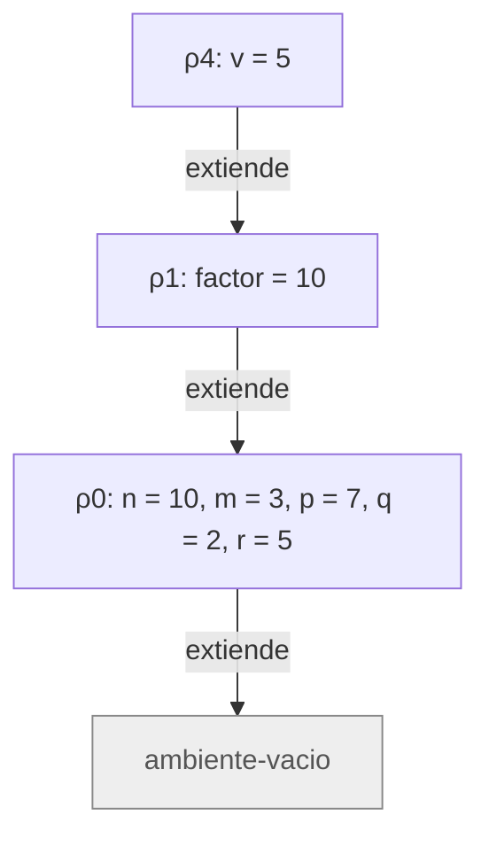
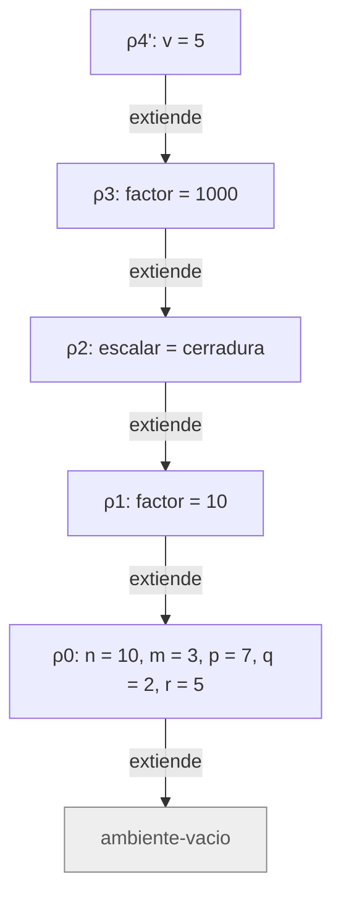
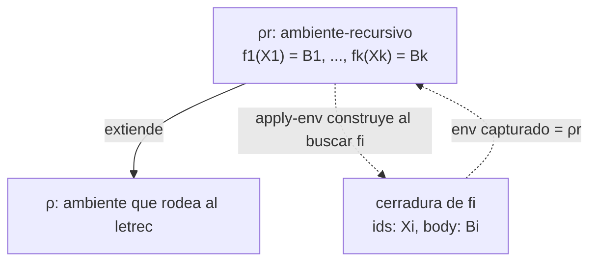

# Informe de corrección — Taller 2: El intérprete de Cauca

**Curso:** Fundamentos de Interpretación y Compilación de Lenguajes
de Programación — Universidad del Valle, Sede Tuluá.

**Integrantes del grupo:**

| Nombre | Código | Correo institucional |
|--------|--------|----------------------|
| Nicolás Cardona García | 2477349 | nicolas.cardona.garcia@correounivalle.edu.co |
| Laura Sofía Echeverry González | 2477067 | echeverry.laura@correounivalle.edu.co |
| Santiago Serrano Morales | 2477006 | serrano.santiago@correounivalle.edu.co |
| Samuel Peña Jaramillo | 2477399 | samuel.pena@correounivalle.edu.co |

---

## 1. Marco formal

### 1.1 Corrección de programas recursivos

Sea $f : A \to B$ una función y $A$ un conjunto definido recursivamente. Sea $P_f$ un programa recursivo en Racket que pretende calcular $f$. Decimos que $P_f$ es **correcto** con respecto a su especificación si se cumple:

$$\forall a \in A,\; P_f(a) = f(a)$$

La estrategia de demostración es la inducción estructural sobre $A$:

- **Caso base:** para cada valor básico $a_0 \in A$ se verifica $P_f(a_0) = f(a_0)$.
- **Caso inductivo:** asumiendo la hipótesis de inducción $P_f(a') = f(a')$ para las subestructuras $a'$ que forman $a$, se demuestra $P_f(a) = f(a)$.

### 1.2 Corrección de programas iterativos

Para un programa iterativo se formalizan:

- Un estado $s$ con componentes relevantes.
- Un estado inicial $s_0$.
- Un estado final reconocido por un predicado $\textit{es-final?}(s)$.
- Una invariante $\mathrm{Inv}(s)$ que se mantiene entre pasos.
- Una transformación $\textit{transformar}(s)$.

La corrección se argumenta demostrando:

1. $\mathrm{Inv}(s_0)$ se cumple al inicio.
2. $\mathrm{Inv}(s) \land \lnot\,\textit{es-final?}(s) \Rightarrow \mathrm{Inv}(\textit{transformar}(s))$.
3. $\mathrm{Inv}(s) \land \textit{es-final?}(s) \Rightarrow \textit{respuesta}(s) = f(\textit{entrada})$.
4. El proceso termina: existe una función de cota estrictamente decreciente sobre $\mathbb{N}$.

Todas las funciones analizadas en este informe son recursivas (directa o mutuamente), por lo que se usa el marco 1.1; el marco 1.2 se incluye por completitud.

---

## 2. Funciones analizadas

El enunciado pide demostrar la corrección de tres piezas del intérprete: `apply-procedure` (con la regla `app-exp` que la invoca), la ligadura recursiva `letrec` (con `apply-env` sobre `ambiente-recursivo`) y `case-exp` (con `seleccionar-caso`).

### Notación común

- $\rho$ es un ambiente. $\varnothing$ es `ambiente-vacio`.
- $\mathrm{ext}(X, V, \rho)$ es `ambiente-extendido` con ids $X = (x_1,\ldots,x_n)$, valores $V = (v_1,\ldots,v_n)$ y ambiente padre $\rho$.
- $\mathrm{rec}(F, \bar X, \bar B, \rho)$ es `ambiente-recursivo` con nombres $F = (f_1,\ldots,f_k)$, listas de parámetros $\bar X = (X_1,\ldots,X_k)$, cuerpos $\bar B = (B_1,\ldots,B_k)$ sin evaluar y ambiente padre $\rho$.
- $\langle X, B, \rho \rangle$ es una `cerradura` con parámetros $X$, cuerpo $B$ y ambiente $\rho$.
- $\rho_0 = [\,n = 10,\ m = 3,\ p = 7,\ q = 2,\ r = 5\,]$ es el ambiente inicial.
- $\textit{value-of}(e, \rho)$ es el valor de la expresión $e$ en $\rho$. Cuando un paso levanta `eopl:error`, se escribe $\textit{error}$.

**Búsqueda de una variable** (`apply-env`). Con $\mathrm{buscar}(\rho, y)$:

$$\mathrm{buscar}(\varnothing, y) = \textit{error}$$

$$\mathrm{buscar}(\mathrm{ext}(X, V, \rho), y) =
\begin{cases}
v_i, \ i = \min\{\, j : x_j = y \,\} & \text{si } y \in X \\
\mathrm{buscar}(\rho, y) & \text{si } y \notin X
\end{cases}$$

$$\mathrm{buscar}(\mathrm{rec}(F, \bar X, \bar B, \rho), y) =
\begin{cases}
\langle X_i, B_i, \mathrm{rec}(F, \bar X, \bar B, \rho) \rangle, \ i = \min\{\, j : f_j = y \,\} & \text{si } y \in F \\
\mathrm{buscar}(\rho, y) & \text{si } y \notin F
\end{cases}$$

En la tercera ecuación el ambiente de la clausura es el propio $\mathrm{rec}(F, \bar X, \bar B, \rho)$ sobre el que se hizo la búsqueda: es la línea `(cerradura (list-ref idss pos) (list-ref bodies pos) env)` de `apply-env`, donde `env` es el argumento de `apply-env` y no `env-padre`.

**Reglas de evaluación usadas:**

$$\textit{value-of}(\texttt{proc-exp}(X, B), \rho) = \langle X, B, \rho \rangle$$

$$\textit{value-of}(\texttt{app-exp}(r, (e_1, \ldots, e_m)), \rho) = \textit{apply-procedure}(v_f, (v_1, \ldots, v_m))$$

con $v_f = \textit{value-of}(r, \rho)$ y $v_i = \textit{value-of}(e_i, \rho)$, evaluados de izquierda a derecha, siempre que $v_f$ sea un procedimiento.

$$\textit{value-of}(\texttt{letrec-exp}(F, \bar X, \bar B, B_0), \rho) = \textit{value-of}(B_0, \mathrm{rec}(F, \bar X, \bar B, \rho))$$

Las demostraciones son de **corrección parcial** respecto a la terminación de las subexpresiones del usuario: si el cuerpo de un procedimiento no termina, ninguna propiedad sobre su valor puede cumplirse. La terminación de cada función del intérprete se argumenta aparte.

---

### 2.1 Corrección de `apply-procedure`

**Especificación.**

- **Tipo:** `apply-procedure` : `procval` $\times$ lista de valores $\to$ valor.
- **Pre-condición:** $\mathrm{Pre}(p, \bar v) \equiv p = \langle X, B, \rho_c \rangle$, con $X = (x_1,\ldots,x_n)$ una lista de símbolos, $B$ una expresión y $\rho_c$ el ambiente vigente cuando se evaluó el `proc-exp`; y $\bar v = (v_1,\ldots,v_m)$ una lista de valores.
- **Post-condición:**

$$\mathrm{Post}(p, \bar v, r) \equiv
\bigl(m = n \;\land\; r = \textit{value-of}(B, \mathrm{ext}(X, \bar v, \rho_c))\bigr)
\;\lor\;
\bigl(m \neq n \;\land\; r = \textit{error}\bigr)$$

**Código.**

```scheme
; apply-procedure : procval x lista de valores -> valor
; Propósito: verifica que la cantidad de argumentos coincida con la de
; parámetros y evalúa el cuerpo en el ambiente de la clausura extendido
; con las ligaduras de los parámetros, no en el ambiente de la llamada.
(define apply-procedure
  (lambda (proc args)
    (cases procval proc
      (cerradura (ids body env-definicion)
        (if (= (length ids) (length args))
            (evaluar-expresion
             body
             (ambiente-extendido ids args env-definicion))
            (eopl:error
             'apply-procedure
             "se esperaban ~s argumento(s) y llegaron ~s"
             (length ids)
             (length args)))))))
```

La regla que construye la clausura y la que la aplica, en `evaluar-expresion`:

```scheme
(proc-exp (ids body)
  (cerradura ids body env))

(app-exp (rator rands)
  (let ((proc (evaluar-expresion rator env)))
    (if (procval? proc)
        (let ((args (evaluar-rands rands env)))
          (apply-procedure proc args))
        (eopl:error 'app-exp "el operador no es un procedimiento: ~s" proc))))
```

**Estrategia de demostración:** análisis por casos sobre la condición `(= (length ids) (length args))` y razonamiento directo sobre el código, que no es recursivo por sí mismo. La recursión aparece solo a través de `evaluar-expresion`, para la cual se usa como hipótesis que es correcta sobre expresiones de menor tamaño (inducción sobre el árbol de evaluación).

#### Demostración de la especificación

`apply-procedure` descompone $p$ con `cases` en $\langle X, B, \rho_c \rangle$ y compara $n = |X|$ con $m = |\bar v|$.

- **Caso $m = n$:** el `if` toma la rama verdadera y retorna `(evaluar-expresion body (ambiente-extendido ids args env-definicion))`, es decir, $\textit{value-of}(B, \mathrm{ext}(X, \bar v, \rho_c))$. Se cumple la primera alternativa de $\mathrm{Post}$.
- **Caso $m \neq n$:** el `if` toma la rama falsa y levanta `eopl:error`. Se cumple la segunda alternativa.

Las dos alternativas son excluyentes y cubren todos los casos, así que $\mathrm{Post}$ se cumple. $\blacksquare$

#### El cuerpo se evalúa en el ambiente de la clausura y no en el de la llamada

**Lema A (la clausura captura el ambiente de definición).** Si $\textit{value-of}(\texttt{proc-exp}(X, B), \rho) = c$, entonces $c = \langle X, B, \rho \rangle$.

*Prueba.* Es la regla `(proc-exp (ids body) (cerradura ids body env))`: el tercer campo es el parámetro `env` de `evaluar-expresion` en el instante de evaluar el `proc-exp`, que es $\rho$. El cuerpo no se evalúa al construir la clausura. $\blacksquare$

**Lema B (`apply-procedure` no conoce el ambiente de la llamada).** El único ambiente que `apply-procedure` puede usar es el que trae la clausura.

*Prueba.* La función solo recibe `proc` y `args`; el ambiente donde ocurre la aplicación, $\rho_{\text{llamada}}$, no es parámetro suyo. En el código, el único ambiente que aparece es `env-definicion`, extraído de la clausura. Por tanto el cuerpo solo puede evaluarse en $\mathrm{ext}(X, \bar v, \rho_c)$. $\blacksquare$

**Teorema.** Si $c = \langle X, B, \rho_c \rangle$ se aplica en una llamada hecha en $\rho_{\text{llamada}}$ con $m = n$ argumentos, el cuerpo se evalúa en $\mathrm{ext}(X, \bar v, \rho_c)$ y no en $\mathrm{ext}(X, \bar v, \rho_{\text{llamada}})$.

*Prueba.* Por el Lema A, $\rho_c$ es el ambiente de definición; por el Lema B, el cuerpo se evalúa extendiendo $\rho_c$. Los argumentos $\bar v$ sí se evalúan en $\rho_{\text{llamada}}$ (regla `app-exp`), pero ese es el único uso que se hace de ese ambiente. $\blacksquare$

#### Ejemplo de contraste de la Parte 3

```
let factor = 10
in
  let escalar = proc (v) *(v, factor) end
  in
    let factor = 1000
    in apply escalar (5) end
  end
end
```

Paso a paso:

| Ambiente | Definición |
|---|---|
| $\rho_1$ | $\mathrm{ext}((\textit{factor}), (10), \rho_0)$ |
| $c$ | $\langle (v),\ \texttt{*(v, factor)},\ \rho_1 \rangle$, porque el `proc-exp` se evalúa en $\rho_1$ |
| $\rho_2$ | $\mathrm{ext}((\textit{escalar}), (c), \rho_1)$ |
| $\rho_3$ | $\mathrm{ext}((\textit{factor}), (1000), \rho_2)$ — ambiente de la llamada |

En `apply escalar (5)` el operador se resuelve en $\rho_3$: $\mathrm{buscar}(\rho_3, \textit{escalar}) = c$, porque `escalar` no está en $\rho_3$ y se busca en $\rho_2$. El argumento vale $5$.

**Evaluación correcta (la implementada).** El cuerpo se evalúa en $\rho_4 = \mathrm{ext}((v), (5), \rho_1)$. Para `factor`: no está en $\rho_4$, se busca en $\rho_1$ y se obtiene $10$. Resultado: $5 \cdot 10 = 50$.

**Evaluación incorrecta (ambiente de la llamada).** El cuerpo se evaluaría en $\rho_4' = \mathrm{ext}((v), (5), \rho_3)$. Para `factor`: no está en $\rho_4'$, se encuentra en $\rho_3$ y se obtiene $1000$. Resultado: $5 \cdot 1000 = 5000$.

Cadena de ambientes que da **50** (flechas del ambiente que extiende hacia el ambiente extendido):



Cadena de ambientes que daría **5000**:



En la primera cadena, la búsqueda de `factor` llega a $\rho_1$ antes que a cualquier ligadura posterior a la definición. En la segunda, encuentra primero $\rho_3$, creado después de la clausura. El intérprete implementa la primera cadena; al ejecutar el ejemplo devuelve `50`.

#### La aplicación levanta error exactamente cuando el operador no es un procedimiento o la cantidad de argumentos no coincide

Se llama *error propio de la aplicación* al que levantan `app-exp` o `apply-procedure` por sí mismos, distinto de los que se propagan desde la evaluación del operador, de los argumentos o del cuerpo.

**Teorema.** Sean $v_f$ el valor del operador y $\bar v = (v_1,\ldots,v_m)$ los valores de los argumentos, y supóngase que su evaluación terminó sin error. La aplicación levanta un error propio si y solo si

$$\lnot\,\textit{procval?}(v_f) \;\;\lor\;\; \bigl(v_f = \langle X, B, \rho_c \rangle \;\land\; |X| \neq m\bigr).$$

*Prueba.*

($\Leftarrow$) Si $\lnot\,\textit{procval?}(v_f)$, la rama falsa del `if` de `app-exp` levanta `"el operador no es un procedimiento"`. Si $v_f$ es una clausura con $|X| \neq m$, `apply-procedure` levanta el error de cantidad, como se demostró arriba.

($\Rightarrow$) En el código de `app-exp` y `apply-procedure` hay exactamente dos llamadas a `eopl:error`: la de `app-exp` en la rama donde `procval?` es falso, y la de `apply-procedure` en la rama donde `(= (length ids) (length args))` es falso. Si se levanta un error propio, se llegó a una de esas dos ramas, y cada una implica una de las dos condiciones del enunciado. Cuando $v_f$ es procedimiento y $|X| = m$, ninguna rama de error se ejecuta; solo podría fallar la evaluación del cuerpo, que no es un error propio. $\blacksquare$

**Orden de las verificaciones.** `app-exp` evalúa el operador y lo verifica con `procval?` antes de evaluar los argumentos. Por eso `apply 5 (variableinexistente)` produce el error del operador y no el de variable no ligada, como comprueban las pruebas de `pruebas-cauca.rkt`.

**Terminación.** `apply-procedure` no es recursiva: hace una comparación de longitudes, a lo sumo una extensión del ambiente y una sola llamada a `evaluar-expresion`. Su terminación depende de la del cuerpo evaluado.

**Conclusión:** `apply-procedure` es correcta respecto a su especificación: evalúa el cuerpo en $\mathrm{ext}(X, \bar v, \rho_c)$, nunca en el ambiente de la llamada, y levanta error exactamente cuando el operador no es un procedimiento o la cantidad de argumentos no coincide con la de parámetros.

---

### 2.2 Corrección de la ligadura recursiva (`letrec` y `apply-env`)

**Especificación.**

- **Tipo:** `letrec-exp` evalúa a valor con `evaluar-expresion` : `expresion` $\times$ `ambiente` $\to$ valor; la pieza clave es `apply-env` : `ambiente` $\times$ `symbol` $\to$ valor.
- **Pre-condición:** $F = (f_1,\ldots,f_k)$ son los nombres declarados, con listas de parámetros $\bar X$ y cuerpos $\bar B$ sin evaluar. Si hay nombres repetidos vale la primera aparición.
- **Post-condición:** el cuerpo $B_0$ del `letrec` se evalúa en $\rho_r = \mathrm{rec}(F, \bar X, \bar B, \rho)$, y cada $f_i$ resuelve a una clausura cuyos parámetros son $X_i$, cuyo cuerpo es $B_i$ y cuyo ambiente es $\rho_r$.

**Código.**

```scheme
; apply-env : ambiente x symbol -> valor
; Busca el identificador en el ambiente, respetando el shadowing de las
; ligaduras más recientes, y levanta eopl:error si no está ligado.
(define apply-env
  (lambda (env id)
    (cases ambiente env
      (ambiente-vacio ()
        (eopl:error 'apply-env "Variable no ligada: ~s" id))
      (ambiente-extendido (ids valores env-padre)
        (let ((pos (posicion-de id ids)))
          (if (number? pos)
              (list-ref valores pos)
              (apply-env env-padre id))))
      (ambiente-recursivo (proc-names idss bodies env-padre)
        (let ((pos (posicion-de id proc-names)))
          (if pos
              (cerradura (list-ref idss pos)
                         (list-ref bodies pos) env)
              (apply-env env-padre id)))))))
```

```scheme
(letrec-exp (proc-names idss bodies body)
  (let ((env-rec
         (ambiente-recursivo proc-names idss bodies env)))
    (evaluar-expresion body env-rec)))
```

**Estrategia de demostración:** razonamiento directo sobre `apply-env`, inducción estructural sobre la cadena de ambientes para las búsquedas a través de extensiones, e inducción sobre el exponente para el ejemplo de la potencia.

#### 1. Invariante

Sea $\rho_r = \mathrm{rec}(F, \bar X, \bar B, \rho)$. El invariante que debe cumplir el ambiente en el que se evalúan los cuerpos de un `letrec` es:

$$\mathrm{Inv}(\rho_r) \;\equiv\; \forall i \in \{1,\ldots,k\} :\; \mathrm{buscar}(\rho_r, f_i) = \langle X_i, B_i, \rho_r \rangle$$

Es decir: cada nombre declarado resuelve a una clausura con sus propios parámetros y cuerpo, y con el **mismo** ambiente $\rho_r$ donde está declarado, que contiene a todos los nombres del `letrec`, incluido el suyo.

Como el cuerpo de $f_i$ se evalúa en $\rho_b = \mathrm{ext}(X_i, \bar v, \rho_r)$, el invariante que importa para la recursión es el heredado:

$$\mathrm{Inv}_{\text{cuerpo}}(\rho_b) \;\equiv\; \forall j :\; f_j \notin X_i \Rightarrow \mathrm{buscar}(\rho_b, f_j) = \langle X_j, B_j, \rho_r \rangle$$

La condición $f_j \notin X_i$ recoge el shadowing legítimo: un parámetro que se llame igual que un procedimiento del `letrec` lo oculta dentro del cuerpo.

#### 2. `apply-env` sobre un ambiente recursivo construye una clausura que cumple el invariante

**Lema 1.** $\mathrm{Inv}(\rho_r)$ se cumple.

*Prueba.* Sea $f_i \in F$ con $i = \min\{j : f_j = f_i\}$. Al evaluar `(apply-env ρr fi)`, el `cases` entra en la variante `ambiente-recursivo`; `posicion-de` devuelve la posición de $f_i$ en `proc-names`, que no es `#f`; y se retorna `(cerradura (list-ref idss pos) (list-ref bodies pos) env)`. Aquí `env` es el argumento de `apply-env`, o sea $\rho_r$ mismo. El valor es $\langle X_i, B_i, \rho_r \rangle$. $\blacksquare$

**Lema 2 (búsqueda a través de extensiones).** Sea $\sigma = \mathrm{ext}(Y_1, W_1, \mathrm{ext}(Y_2, W_2, \ldots \mathrm{ext}(Y_t, W_t, \rho_r)))$ con $f_j \notin Y_s$ para todo $s$. Entonces $\mathrm{buscar}(\sigma, f_j) = \mathrm{buscar}(\rho_r, f_j)$.

*Prueba.* Por inducción sobre $t$. Si $t = 0$, $\sigma = \rho_r$ y el resultado es inmediato. Si $t > 0$, como $f_j \notin Y_1$, la segunda ecuación de $\mathrm{buscar}$ da $\mathrm{buscar}(\sigma, f_j) = \mathrm{buscar}(\sigma', f_j)$, con $\sigma'$ la cadena de $t - 1$ extensiones. Se aplica la hipótesis de inducción. $\blacksquare$

**Teorema.** Para todo cuerpo $B_i$ evaluado por `apply-procedure` sobre la clausura que entrega `apply-env`, $\mathrm{Inv}_{\text{cuerpo}}(\rho_b)$ se cumple, y las llamadas recursivas y mutuas resuelven correctamente.

*Prueba.* Por el Lema 1, $\mathrm{buscar}(\rho_r, f_i) = \langle X_i, B_i, \rho_r \rangle$, luego `apply-procedure` evalúa $B_i$ en $\rho_b = \mathrm{ext}(X_i, \bar v, \rho_r)$ (Lema A de 2.1). Si $f_j \notin X_i$, el Lema 2 con $t = 1$ da $\mathrm{buscar}(\rho_b, f_j) = \mathrm{buscar}(\rho_r, f_j)$, y por el Lema 1 esto es $\langle X_j, B_j, \rho_r \rangle$. Por tanto $\mathrm{Inv}_{\text{cuerpo}}(\rho_b)$ se cumple.

El invariante se preserva en cada llamada porque $\rho_r$ es inmutable: ninguna llamada lo modifica, y toda clausura creada para un nombre de este `letrec` lleva exactamente $\rho_r$. Una llamada recursiva ($j = i$) o mutua ($j \neq i$) a $f_j$ dentro de $B_i$ vuelve a encontrar $\langle X_j, B_j, \rho_r \rangle$ y el argumento se repite. $\blacksquare$

Estructura de la cadena (el ambiente de la clausura es el propio ambiente recursivo):



#### 3. Por qué la misma declaración con `let` no cumple el invariante

Con `let`, los rands se evalúan **en el ambiente de afuera**:

$$\textit{value-of}(\texttt{let-exp}((f), (\texttt{proc-exp}(X, B_f)), B_0), \rho) = \textit{value-of}(B_0, \mathrm{ext}((f), (c), \rho)), \quad c = \langle X, B_f, \rho \rangle.$$

La clausura $c$ captura $\rho$, no $\mathrm{ext}((f), (c), \rho)$: en el momento de construirla, $f$ todavía no está ligada. Entonces $\mathrm{buscar}(\mathrm{env}(c), f) = \mathrm{buscar}(\rho, f)$, que no es $c$. El invariante se viola.

**Error concreto.** Al aplicar $c$, el cuerpo $B_f$ se evalúa en $\mathrm{ext}(X, \bar v, \rho)$. La ocurrencia recursiva de $f$ se busca ahí; si $f \notin \rho$, la búsqueda llega a $\varnothing$ y se levanta el error de variable no ligada. Con el intérprete:

```
let factorial = proc (n)
                  if ==(n, 0) then 1
                  else *(n, apply factorial (sub1(n))) end
                end
in apply factorial (5) end
```

devuelve el error `apply-env: Variable no ligada: factorial`, mientras que la versión con `letrec` devuelve `120`.

Si $f$ ya estaba ligada en $\rho$ a otra cosa, el error es peor porque pasa en silencio: la llamada recursiva usa la ligadura **anterior**. Por ejemplo, `let f = proc (n) 100 end in let f = proc (n) apply f (n) end in apply f (1) end end` devuelve `100`, porque el `f` interno llama al externo y no a sí mismo.

#### 4. Terminación del ejemplo de la potencia

```
letrec
  potencia (base, exp) = if ==(exp, 0)
                         then 1
                         else *(base, apply potencia (base, sub1(exp)))
                         end
in
  apply potencia (2, 10)
end
```

**Medida decreciente.** $\mu(\textit{base}, \textit{exp}) = \textit{exp}$, un natural. En cada llamada recursiva el argumento es `sub1(exp)`, de modo que $\mu' = \mu - 1 < \mu$. Como $\mu \geq 0$ está acotada inferiormente por $0$, no puede decrecer indefinidamente. La rama `else` solo se evalúa si $\textit{exp} \neq 0$, y el `if` evalúa únicamente la rama elegida, por lo que cuando $\mu = 0$ no se produce otra llamada.

Para `potencia(2, 10)` la medida toma los valores $10, 9, \ldots, 1, 0$: son 11 invocaciones de $B_{\text{potencia}}$ (10 recursivas y el caso base).

**Condición.** La terminación exige $\textit{exp} \in \mathbb{N}$. Con $\textit{exp} = -1$ o $\textit{exp} = 1.5$ la medida nunca llega a $0$ y la recursión diverge; la pre-condición del procedimiento es $\textit{exp} \in \mathbb{N}$.

**Corrección del valor.** Por inducción sobre $e = \textit{exp}$ se prueba $\textit{potencia}(b, e) = b^e$:

- **Base ($e = 0$):** la condición $\textit{exp} = 0$ es verdadera y retorna $1 = b^0$.
- **Paso ($e > 0$):** retorna $b \cdot \textit{potencia}(b, e - 1)$, que por hipótesis de inducción es $b \cdot b^{e-1} = b^e$.

Para $b = 2$ y $e = 10$ se obtiene $2^{10} = 1024$, que es el resultado del ejemplo del enunciado.

**Conclusión:** la implementación de `letrec` es correcta: `apply-env` sobre un `ambiente-recursivo` construye clausuras que cumplen $\mathrm{Inv}$, `let` no puede cumplirlo, y la recursión del ejemplo termina porque el exponente decrece estrictamente hasta $0$.

---

### 2.3 Corrección de `case-exp`

**Especificación.**

- **Tipo:** `case-exp` evalúa a valor con `evaluar-expresion` : `expresion` $\times$ `ambiente` $\to$ valor, y `seleccionar-caso` : número $\times$ lista de números $\times$ lista de expresiones $\times$ expresión $\times$ ambiente $\to$ valor.
- **Pre-condición:** $\texttt{case-exp}(e, (k_1, \ldots, k_m), (a_1, \ldots, a_m), d)$ con $m \geq 1$ (la gramática exige una primera rama), $k_i$ números literales, $a_i$ y $d$ expresiones.
- **Post-condición.** Sea $v = \textit{value-of}(e, \rho)$:

$$\mathrm{Post} \equiv
\begin{cases}
\textit{error} & \text{si } v \text{ no es número} \\
\textit{value-of}(a_i, \rho),\ i = \min\{\, j : k_j = v \,\} & \text{si } v \text{ es número y } \exists j.\, k_j = v \\
\textit{value-of}(d, \rho) & \text{si } v \text{ es número y } \forall j.\, k_j \neq v
\end{cases}$$

Además, $e$ se evalúa exactamente una vez, y ninguna $a_j$ distinta de la elegida ni $d$ cuando hay coincidencia, se evalúa.

**Código.**

```scheme
; seleccionar-caso : numero x lista de numeros x lista de expresiones
;                    x expresion x ambiente -> valor
; Busca la primera alternativa cuyo valor coincide con el control.
; Si ninguna coincide, evalua la expresion predeterminada.
(define seleccionar-caso
  (lambda (control valores acciones default env)
    (cond
      [(null? valores)
       (evaluar-expresion default env)]
      [(= control (car valores))
       (evaluar-expresion (car acciones) env)]
      [else
       (seleccionar-caso control (cdr valores) (cdr acciones) default env)])))
```

```scheme
(case-exp (exp primer-valor primera-accion valores acciones default)
  (let ((control (evaluar-expresion exp env)))
    (if (number? control)
        (seleccionar-caso control (cons primer-valor valores)
                          (cons primera-accion acciones) default env)
        (eopl:error 'case-exp
                    "El valor de control debe ser numerico: ~s"
                    control))))
```

**Estrategia de demostración:** inducción estructural sobre la lista de ramas de `seleccionar-caso` (cuyo tipo de datos es la lista, definida recursivamente por *vacía* y *cons*).

#### Demostración por inducción estructural sobre la lista de ramas

**Propiedad $S(L)$**, para una lista de ramas $L = ((k_1, a_1), \ldots, (k_m, a_m))$ y un número $c$:

$$\textit{seleccionar-caso}(c, L, d, \rho) =
\begin{cases}
\textit{value-of}(a_i, \rho),\ i = \min\{\, j : k_j = c \,\} & \text{si } \exists j.\, k_j = c \\
\textit{value-of}(d, \rho) & \text{si no}
\end{cases}$$

- **Caso base ($L$ vacía, $m = 0$).** `(null? valores)` es verdadero y se retorna `(evaluar-expresion default env)`, o sea $\textit{value-of}(d, \rho)$. No existe $j$ con $k_j = c$, así que la propiedad pide $\textit{value-of}(d, \rho)$. Se cumple.

- **Caso inductivo ($L = (k_1, a_1) :: L'$).** Se asume $S(L')$. Hay dos subcasos:
  - Si $k_1 = c$: la segunda cláusula del `cond` se cumple (`(= control (car valores))`) y retorna `(evaluar-expresion (car acciones) env)`, es decir $\textit{value-of}(a_1, \rho)$. Como $1$ es el mínimo índice posible, coincide con $\min\{j : k_j = c\}$.
  - Si $k_1 \neq c$: se llega a la rama `else` y se llama recursivamente con $L'$. Por hipótesis $S(L')$ el resultado es $\textit{value-of}(a_{i'}, \rho)$ donde $i'$ es el primer índice de $L'$ con coincidencia, o $\textit{value-of}(d, \rho)$ si no hay ninguna. Como $k_1 \neq c$, el primer índice de coincidencia en $L$ es el de $L'$ desplazado una posición, y existe coincidencia en $L$ si y solo si existe en $L'$. La propiedad se cumple para $L$.

Por inducción estructural, $S(L)$ vale para toda lista $L$. $\blacksquare$

**Se evalúa la acción de la primera coincidencia y `otherwise` cuando no hay ninguna.** Es $S(L)$ aplicada a $L = ((k_1, a_1), \ldots, (k_m, a_m))$ con $m \ge 1$: `case-exp` llama a `seleccionar-caso` con `(cons primer-valor valores)` y `(cons primera-accion acciones)`, que reconstruyen esa lista completa. Las acciones no elegidas no se evalúan: solo la rama del `cond` que se cumple llama a `evaluar-expresion`, y lo hace una sola vez, sobre `(car acciones)` o sobre `default`. Por ejemplo, `case 1 of 1 => 10 of 2 => zzz otherwise => yyy end` devuelve `10` aunque `zzz` e `yyy` no estén ligadas.

**Error cuando el valor de control no es un número.** En `case-exp`, tras evaluar el control, la condición `(number? control)` decide: si es falsa, se levanta `eopl:error` y `seleccionar-caso` nunca se invoca; si es verdadera, no hay ninguna llamada a `eopl:error` en `case-exp`, y la comparación `=` de `seleccionar-caso` solo recibe números (el control, ya verificado, y los literales `k_i`, que el léxico garantiza numéricos), así que no puede fallar por tipo. Por tanto el error ocurre exactamente cuando el valor de control no es número. Con el intérprete, `case true of 1 => 1 otherwise => 0 end` levanta `El valor de control debe ser numerico: #t`.

#### La expresión de control se evalúa una sola vez

**Teorema.** Para todo $m \geq 1$, la expresión de control $e$ se evalúa exactamente una vez.

*Prueba.* En el código de `case-exp`, la única llamada a `evaluar-expresion` sobre `exp` es la del `let`, que liga el resultado a la variable `control`; esa llamada se hace una vez por evaluación del `case-exp`. A partir de ahí, `seleccionar-caso` recibe `control`, que es un **valor** (un número) y no la expresión: su firma no incluye `exp`, y sus únicas llamadas a `evaluar-expresion` son sobre `(car acciones)` y `default`. Por la propiedad $S$, esas llamadas ocurren a lo sumo una vez en total. Así, el número de evaluaciones de $e$ es $1$ y no depende de $m$. $\blacksquare$

La alternativa que se evita —incorrecta— sería comparar `(evaluar-expresion exp env)` en cada rama, con lo que $e$ se evaluaría hasta $m$ veces; la diferencia con `if` es exactamente que aquí se compara contra literales fijos con un valor ya calculado.

#### Terminación del recorrido sobre las ramas

La medida es $\mu(L) = |L|$, la longitud de la lista `valores`. En cada llamada recursiva de `seleccionar-caso` se pasa `(cdr valores)`, por lo que $\mu' = \mu - 1$. Como $\mu \in \mathbb{N}$, la secuencia decreciente es finita y alcanza $0$ a lo sumo después de $m$ llamadas, momento en el que `(null? valores)` detiene la recursión. La rama `else` es la única recursiva y siempre reduce la lista. Como resultado, el recorrido hace a lo sumo $m$ comparaciones y una única evaluación final de una acción o de `default`; el recorrido termina siempre, y la terminación total depende solo de la expresión elegida.

**Conclusión:** `case-exp` es correcta respecto a su especificación: evalúa el control una vez, selecciona la primera coincidencia, cae en `otherwise` si no hay ninguna, levanta error si el control no es numérico, y su recorrido termina.

---

## 3. Propiedades adicionales

Las demostraciones anteriores usan dos propiedades del intérprete que se enuncian y prueban aquí. Las demás propiedades de la plantilla (almacén, transacciones, paso por referencia y chequeo de tipos) no aplican a Cauca, que no tiene almacén ni bloques transaccionales ni tipos estáticos.

### 3.1 Shadowing en `apply-env`

**Enunciado.** Si $\rho = \mathrm{ext}(X, V, \sigma)$ y $y \in X$, entonces $\mathrm{buscar}(\rho, y) = v_i$ con $i = \min\{j : x_j = y\}$, sin importar lo que contenga $\sigma$. Es decir, la ligadura más reciente tiene prioridad sobre las anteriores.

**Demostración.** Se prueba primero que `posicion-de` devuelve la primera posición. Sea `buscar` la función auxiliar interna con parámetros `lst` e `i`; se prueba por inducción sobre `lst` que `(buscar lst i)` retorna `#f` si `y` no está en `lst`, y $i + (\text{posición de la primera aparición de } y \text{ en } lst)$ si está.

- **Base (`lst` vacía):** retorna `#f`, y `y` no está.
- **Paso (`lst` $= a :: lst'$):** si `(eqv? a y)` retorna `i`, la primera posición. Si no, retorna `(buscar lst' (+ i 1))`, que por hipótesis de inducción es $i + 1 + \text{pos}_{lst'}$ o `#f`; y la primera aparición en `lst` es la de `lst'` más uno, ya que $a \neq y$.

Con `i` inicial $0$, `posicion-de` retorna la primera posición. En `apply-env`, para $y \in X$ el `if` toma la rama verdadera y retorna `(list-ref valores pos)`, es decir $v_i$ con $i$ mínimo; la llamada recursiva sobre `env-padre` no se hace. $\blacksquare$

### 3.2 Evaluación de izquierda a derecha en `evaluar-rands`

**Enunciado.** `evaluar-rands` evalúa $e_1, e_2, \ldots, e_n$ en ese orden, todas en el mismo ambiente $\rho$, y retorna $(v_1, \ldots, v_n)$ con $v_i = \textit{value-of}(e_i, \rho)$.

**Demostración.** Por inducción sobre la lista de expresiones.

- **Base (lista vacía):** retorna `'()`, sin evaluar nada.
- **Paso ($e_1 :: \textit{resto}$):** el código liga con `let` el valor de `(evaluar-expresion (car rands) env)` **antes** de la llamada recursiva sobre `(cdr rands)`, por lo que $e_1$ se evalúa primero. Luego, por hipótesis de inducción, el resto se evalúa de izquierda a derecha en el mismo `env`, y el resultado es `(cons v1 resto-valores)`.

Esto sustenta, por ejemplo, que `apply tomar (primera, segunda)` falle con la variable `primera` y no con `segunda` cuando ninguna está ligada, como verifica la suite de procedimientos. 

---

## 4. Referencias

- Friedman, D. P., & Wand, M. *Essentials of Programming Languages*,
  3.ª ed., MIT Press, 2008. Secciones 1.1 (especificación inductiva y
  demostración por inducción estructural), 2.2 (ambientes),
  3.2 (el lenguaje LET), 3.3 (procedimientos y clausuras, Figura 3.7) y
  3.4 (procedimientos recursivos, Figura 3.9).
- The Racket Guide, *Parsing with SLLGEN*, en la documentación del
  lenguaje `eopl`.
- RackUnit, *Unit Testing*: <https://docs.racket-lang.org/rackunit/>.